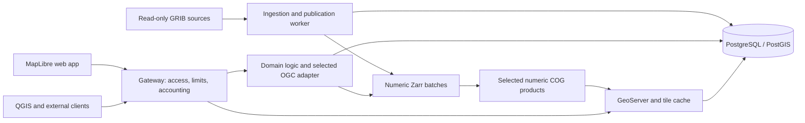

# Hydrometcenter meteorology prototype — specification

Version: 0.2 · 2026-10-19 · **Accepted implementation handoff.**

The user accepted revision 0.2, milestones M1–M5 and acceptance criteria A1–A12 on 2026-10-19. Implementation gates remain to be performed; acceptance records planning agreement.

Revision 0.2 addresses the requested OGC API comparison. The user accepted selecting the numerical adapter through the M1 comparison gate on 2026-10-19. The adapter remains to be selected during implementation. The storage, QGIS, interaction and Martin-deferral decisions remain accepted.

[Russian copy](spec.ru.md) · [Decision map](map.md) · [Domain glossary](../../GLOSSARY.md)

## 1. Purpose and scope

Build a self-hosted meteorology prototype that proves ingestion of the supplied GRIB2 file, numerical normalization, web-map publication and authenticated external access from QGIS. The product has a Russian interface and UTC timestamps. This document is the implementation handoff; the present wayfinder effort delivers planning artifacts rather than the deployed application.

The first release includes the sample's available temperature field and forecast times, a responsive map with legend/time controls/value inspection, documented APIs, organization keys/limits/usage records, incremental publication, retention and operational diagnostics. It establishes interfaces for later imagery, observations, hydrology and long-term forecasts.

Native mobile, production integration of tens of sources, live database connections, wind particles, numerical raster downloads, payments, tariffs and Martin/vector layers are deferred. A future module need not use the meteorology storage formats.

## 2. Evidence and planning envelope

| Item | Requirement or evidence |
| --- | --- |
| Input | `data/grib/ICON_EU_T_G_2026101500.grib2`, 26,658,586 bytes |
| Preliminary inventory | 24 messages; reference time 2026-10-15 00:00 UTC; hourly leads +1…+24; 1377 × 657 regular geographic grid |
| Field identity | Parameter codes 0/0/0; encoded surface type 1. Verify as surface temperature; do not label it 2 m air temperature. |
| Decoder gate | Packing template 5.42 requires successful CCSDS decoding with the selected AEC-enabled ecCodes build. |
| Wider workload | Tens of models; individual files up to several GB; some source updates every 15 minutes, others hourly |
| Audience | Fewer than 100 concurrent users is a planning estimate, not demonstrated capacity. |
| Retention | Initially seven days by model-run reference time; configurable toward 30 days |
| Hosting | One organization-controlled Linux server, Docker Compose, self-hosted runtime; internet available for setup |

The sample's values, units, masks, ranges and orientation have not been decoded or validated. No throughput measurements exist. Update frequency does not by itself establish the number of distinct model runs. Server sizing is explicitly deferred. See [sample inventory](assets/sample-inventory.md).

## 3. Architecture and responsibilities

| Compose responsibility | Implementation direction |
| --- | --- |
| Edge | TLS/reverse proxy, public/protected routing, request identification, authentication/limits/accounting before protected cache access |
| Web | Static Russian web application, TypeScript and MapLibre; locally served styles, fonts and basemap resources |
| API | Domain catalogue, availability, selection and organization access; numerical standards adapter selected through the M1 gate |
| Worker | Source inventory, decoding, normalization, derivatives, validation, publication, retries and cleanup; durable jobs in PostgreSQL |
| GIS | GeoServer/ImageMosaic temporal WMS, browser raster delivery and bounded tile cache |
| Database | PostgreSQL/PostGIS metadata, manifests, jobs, consumer/key records and usage; separate application and mosaic schemas/roles |

The API and worker share domain code and product identifiers; they can use the same image with different commands. No separate service per subject-area module is required. Initial deployment does not require Kubernetes, public cloud storage, a distributed queue or a standalone Martin container. Exact image/library versions are locked during the compatibility milestone.

### 3.1. OGC API alternatives and selection gate

No evidence establishes pygeoapi as the most efficient server for this workload. Existing Zarr/EDR support makes it a relevant integration candidate; efficiency includes response latency, successful throughput, CPU/RAM/I/O, publication refresh and maintenance effort. Feature-serving benchmarks do not rank numerical array adapters.

| Candidate | Relevant strengths | Fit/limitations for this prototype |
| --- | --- | --- |
| pygeoapi | Existing Zarr/NetCDF Xarray EDR Position/Cube providers; broad standard adapters | Numerical shortlist; forecast run/revision integration remains custom and stock Instances support is absent. No performance win established. |
| ldproxy | Features/CRS/filtering/Tiles and PostGIS schema mapping | Future feature-service candidate; direct Zarr/EDR serving was not established in its documented provider inventory. |
| GeoServer OGC APIs | Reuse already-planned GIS server and feature catalogue | Features extension has documented tested Core/CRS support. Separate Maps/Tiles/Coverages modules have different maturity/implementation limits; do not equate them with mature WMS. No direct Zarr EDR path established. |
| TiPG | Focused Features/Tiles over PostGIS and SQL functions | Future vector candidate; documented Features CRS Part 2 gap and no direct Zarr EDR path. |
| pg_featureserv | Focused SQL/table/function feature service | Future narrow PostGIS candidate; not the numerical array or temporal raster service. |
| Narrow Xarray/HTTP adapter | Direct access to the same domain sampling implementation and precise forecast behavior | Numerical comparator; project owns its OGC resources, schemas, encodings, errors and conformance work. |

See the [primary-source comparison](../../docs/research/ogc-api-alternatives.md), [pygeoapi EDR matrix](https://docs.pygeoapi.io/en/stable/publishing/ogcapi-edr.html), [ldproxy specifications](https://docs.ldproxy.net/references/specifications), [GeoServer Features status](https://docs.geoserver.org/stable/en/user/services/features/status/) and [TiPG implementation matrix](https://developmentseed.org/tipg/). Pin a released implementation and matching documentation during M1; moving documentation and beta modules are not deployment evidence.

Accepted M1 gate: compare pygeoapi with a narrow adapter calling the **same** manifest-backed Zarr sampling function. Require equal values/masks, exact time/run/revision, unavailable-data handling, output meaning and gateway policy before comparing speed. Fix the host/container budgets, dependency versions, data hashes, chunking, request mix and worker counts; separate cold/warm caches and repeat measurements. Measure point/metadata operations required now; use time-series/cube queries only as explicitly labelled future-workload experiments. Report p50/p95/p99, successful throughput, errors, CPU/RSS/I/O, bytes, publication freshness and custom integration work. Agree resource/latency thresholds for the measurement host before declaring a winner; do not infer a production SLA from the sample.

Select one numerical adapter before freezing M3 implementation; do not ship all candidates. Reuse GeoServer for temporal WMS. Compare feature-service candidates only when representative vector schemas/data become available. This preserves one external contract and permits different engines for different operations.

## 4. Data identity and ingestion

Identify every field by provider/model, reference time, parameter/table identifiers, surface/level or layer bounds, grid, member where applicable, valid time or interval, and source revision. Preserve statistical processing semantics for future accumulated/averaged products. File, model run and valid time are different concepts.

Source adapters expose local/read-only mounted paths now; file-server protocol and credentials are configured when access is supplied. Detect completed files using a producer manifest/atomic-delivery signal when available. Otherwise use a documented stability delay plus structural validation/retry, acknowledging that stability alone cannot prove producer completeness. Partial/truncated/unsupported files are quarantined.

Use source checksum and pipeline version for idempotence. Preserve original bytes in managed storage if continued retrievability on the source server is not guaranteed. Record provenance and decoder/definition versions. Process bounded compatible batches instead of assuming a GB-scale file can be loaded in full without resource limits.

## 5. Hybrid storage and selected map products

Zarr is the normalized numerical core. Start the compatibility exercise with explicit Zarr format 2 and lossless encoding; pin the tested writer/reader/codecs rather than relying on package defaults. Preserve coordinates, units, masks and GRIB metadata. A provider resolves a published manifest into the required field/time view.

Use immutable batches per available field/time group, partitioned by compatible grid/level structure. A small immutable run manifest reuses unchanged batches; late/corrected data create replacement batches and a new revision. Do not copy the entire growing run for every publication. Compaction of sealed runs is a later measured optimization, with old references retained until safe to remove.

Publication profiles configure the fields/levels normalized and the subset exposed as map products. For the sample, ingest all 24 messages and publish every successfully validated time of its sole field. Generate numeric COGs **from those Zarr batches**, with lossless encoding, masks and overviews. Keep native-grid numerical identity; GeoServer handles map reprojection. Display overviews are not the source for point values.

The prototype must prove numerical round trips against the ecCodes baseline. Preserve finite values and masks in the Zarr core. Any COG dtype conversion needs a recorded variable-specific tolerance; for the sample temperature, use a maximum absolute conversion error of 0.0001 K as the initial engineering acceptance bound. A failing bound blocks publication. Validate cell centres, scanning direction, longitude normalization and half-cell georeferencing explicitly.

The hybrid adds derivative CPU/storage and publication coordination. No storage or speed advantage has been established. Later chunk/pyramid choices require measurements.

## 6. Publication and failure behavior

Lifecycle: `discovered → staged → decoded → normalized → derivatives_ready → validated → published`; failed stages retain diagnostics and support retry. Track progress per field/time. Run completeness is separate from usability: one validated map-ready time is enough to make a partial run usable. Without an expected producer inventory, completeness is unknown rather than inferred.

A shared published revision becomes visible only when the required Zarr batch, COG and GIS selection are durable, validated and queryable. Keep internal staging and GeoServer administrative routes private. Constrain all public capabilities/map/identify/tile/numeric requests to the selected manifest. A PostgreSQL transaction alone does not synchronize independent GeoServer index changes: the integration milestone must prove the visibility gate and revision-filtered granule selection, including discovery metadata.

Publish new validated times incrementally. Readers pin run and revision; corrections never overwrite assets referenced by a published revision. Cache identities include run/revision, field, level, time, grid/member, style/resampling and tile coordinates. New run arrival and new revision availability do not silently change the user's selection.

Derivative/indexing failure leaves the previous usable revision intact. Recovery after worker restart must be idempotent; abandoned stages are collectable. Use bounded jobs, concurrency, retries and disk/cache budgets.

## 7. API and GIS contract

The following contract is independent of the OGC server selected through M1. Domain logic resolves explicit run/revision/time selection before reading normalized data. If pygeoapi is chosen, its stock Zarr EDR provider still needs custom provider/routing integration; if the narrow adapter is chosen, the project must implement the advertised OGC profile explicitly. Use `run` and `revision` as documented query extensions to the initial EDR profile; do not claim standard Instances support without implementing it.

| Interface | Initial contract |
| --- | --- |
| `/ogc/collections` and collection metadata | Discover approved public products and available query/portrayal links |
| `/ogc/collections/{collectionId}/position` | EDR position query with `coords`, `datetime`, `parameter-name`, and explicit `run`/`revision`; CoverageJSON response |
| `/api/v1/modules`, `/api/v1/models`, model/run/revision listings | Domain catalogue and availability; actual identifiers and available dimensions |
| `/api/v1/point` | Convenient documented numerical query using layer/run/revision/valid_time/lon/lat; same resolver as EDR |
| `/gis/v1/runs/{runId}/revisions/{revision}/wms` | Gateway-scoped WMS 1.3.0 connection for the selected run/revision; capabilities, map, legend and identify |
| Browser tile links from catalogue | Stable published selection; cacheable raster delivery with declared matrix set/style |

Coordinates in the domain point API are named longitude/latitude in degrees. EDR follows the advertised CRS/profile. WMS follows its version/CRS axis rules; do not reuse one ordering blindly across interfaces. A point response reports selection identity, selected native-cell coordinate, units, sampling method, value or explicit no-data reason, and provenance. Default spatial sampling is nearest native cell; temporal selection is exact.

For the domain API, distinguish invalid input (400), credentials (401/403), unavailable selection (404), expired retained data (410), limits (429), and transient processing/service failure (503). A valid location with no coverage/nodata returns an explicit null result and reason, never an edge-cell substitution. OGC endpoints use their documented exception/response profiles. Missing requested times never choose a nearest time or another run. Publish OpenAPI and runnable examples; pin the supported QGIS version during integration.

QGIS must connect with an organization key header, select available times, render the same field and inspect values consistent with the numerical baseline. The scoped WMS URL makes run/revision choice explicit; its advertised links and time domain must retain that scope. Validate EPSG:4326 and EPSG:3857, masks, legends and full-resolution identify. Do not claim general OGC conformance from product installation alone.

OGC API Tiles/Maps facades can be enabled after dimension forwarding is proved. Coverage downloads and broader EDR queries are deferred. Martin is reserved for later feature layers; scientific U/V fields and dense scalar arrays are not automatically MVT products.

## 8. Access, usage and future billing

The demo map is public and uses no organization secret. External organizational API/GIS access uses independently revocable keys, organization-level limits and usage records. Check credentials and quotas before protected cache delivery; prevent direct backend or asset routes bypassing that contract. Public demo access has separate resource limits.

Provide operator commands to create/revoke/rotate keys and configure limits; an administration portal is unnecessary for this milestone. Bound rendering dimensions, concurrent requests, request duration and output size as well as request rate. Store protected key representations, not recoverable raw keys in logs. Record request ID, organization/key ID, operation, selected product/run/revision, UTC time, status, duration, bytes and cache outcome where available. Include cache hits and rejected requests; document retry/accounting behavior. Payments, monetary calculation and tariff policy are not implemented. Public data remain publicly viewable regardless of future API charging policy.

## 9. Web experience

Use Russian labels, UTC timestamps, a full-screen map, compact model/field/run controls, bottom time bar, stable product legend and point card. Small screens use a collapsible control sheet without losing run/time context. Show only implemented modules/products. Include source attribution, data age, reference time, valid time, availability and completeness/unknown status.

Default to the newest usable run and its first available time. Selecting another run starts at its first available time. Keep run and revision fixed while navigating; unavailable times are marked and selecting one clears the layer/value. New data produce a notification; switching runs or refreshing availability is explicit. Changing time/run clears stale point results, and late responses for an earlier selection are discarded.

Differentiate loading, missing time, outside coverage, native nodata and service error. Update failure retains the last published data. Initial styles cover the actual surface-temperature field; no wind animation or fabricated observation layer appears. Basemap/style/font resources are locally served with attribution and verified redistribution rights; a simple regional basemap is sufficient for the first release.

## 10. Retention and operations

Retain runs whose reference times are within the last seven days, including all their published forecast times even when valid times extend beyond that window. Configure the duration toward 30 days without changing identifiers. Retention is for application-managed originals/copies, Zarr batches, COGs, manifests and caches; organization source mounts are never cleanup targets.

Expire discovery/access first; remove unreferenced assets after bounded in-flight-reader grace. Superseded revisions have a configurable grace/budget; sessions cannot pin files forever. Bound cache lifetimes by eligibility. Expired selections return a clear response and prompt reselection. Provide cleanup dry-run and usage reporting. Pin the historical sample in demo mode or use a fixed demonstration clock.

Persist database and products on explicit volumes. Configure secrets outside committed data/config; mount reader assets read-only where possible. Define source readiness, worker/API/database/GIS health, structured logs, job backlog, publication lag, failures, storage and cache use. Back up the catalogue/config/key metadata and document recovery from retained sources; usage retention is separately configurable. Offline runtime must not require public basemap/API calls. Host sizing and public TLS/domain provisioning are deployment inputs, not completed work.

## 11. Implementation sequence

| Milestone | Deliverable and exit gate |
| --- | --- |
| M1 — Decode, compatibility and API comparison | Reproducible tools; all sample messages decoded; field/units/grid/masks and numeric round trip validated; locked storage readers; evidence-based numerical adapter choice under section 3.1 |
| M2 — Publication core | Durable jobs, immutable batches/manifests, selected derivatives, idempotent retries and retention; prove failed updates preserve previous data |
| M3 — GIS and API | GeoServer selection/visibility gate, scoped QGIS WMS, selected OGC adapter discovery/position and domain catalogue/point API; consistent run/time/values and authenticated access |
| M4 — Web map | Russian MapLibre viewer with accepted interaction, UTC, legend, click values, responsive controls and local basemap |
| M5 — Operational handoff | Keys/limits/usage, restart/cleanup/recovery exercises, documentation and configurable concurrent-load measurements |

Do not hide failed compatibility gates behind mock data or silently replace the selected architecture. Record evidence and revisit the affected decision if the chosen products cannot satisfy it.

## 12. Acceptance and measurement

| ID | Required evidence during implementation |
| --- | --- |
| A1 | All 24 sample messages decode; identities, times, surface, units, masks and coordinate placement are recorded and checked. |
| A2 | Zarr numeric baseline and COG derivatives meet precision/mask checks at representative cells and boundaries. |
| A3 | Browser, domain point API, standard position API and QGIS show the same selected run/revision/time/field and consistent values. |
| A4 | QGIS capabilities/time/legend/identify work with credentials in the pinned client version and both stated CRSs. |
| A5 | Explicit synthetic fixtures exercise overlapping runs, missing times, late/corrected batches and old-revision readers without silent mixing. |
| A6 | Crash/retry and derivative/indexing failure never expose unfinished assets or replace the last usable publication. |
| A7 | Public and protected routes behave as documented; invalid/revoked keys, limits, cache hits and usage records are exercised. |
| A8 | Russian UI/UTC, loading/errors/nodata, point-result clearing and stale-response rejection match the reviewed behavior. |
| A9 | Seven-/30-day policy configurations expire managed runs safely; source mounts remain intact; historical demo data remain usable. |
| A10 | Compose startup/restart, persistent storage, health and recovery documentation work on the agreed Linux host. |
| A11 | A runtime network check confirms locally served basemap/styles/fonts and no required public runtime services. |
| A12 | Benchmark report records workload/hardware/configuration, the equivalent-adapter comparison in section 3.1, and measured ingestion, publication lag, latency, CPU/RAM, bytes, temporary/final storage, cache rate, errors and backlog. |

Use the sample for correctness, then representative multi-GB/multivariable/model updates for sizing. Exercise cold/warm maps and clicks while ingesting, with configurable concurrency such as 1/10/50/100 clients. These are measurement profiles, not a guarantee that 100 clients meet an unspecified SLA. Compare seven- and 30-day storage envelopes and account for raw copies, Zarr, selected COGs/overviews, staging, old revisions and cache. The missing production volume/server envelope prevents a defensible capacity commitment today.

## 13. Extensions and unresolved inputs

Register each subject-area module's catalogue, source adapters, products/query capabilities and access policy through the common domain interfaces. GeoTIFF imagery can reuse selected raster publication; station/vector observations and future PostGIS hydrology can introduce OGC API Features and Martin tiles when sample schemas exist. Evaluate reuse of GeoServer Features, ldproxy, TiPG or pg_featureserv against those real schemas before adding another engine. Mobile clients reuse the versioned HTTP interfaces. Long-term forecasts may need different temporal/ensemble semantics; do not force them into a single deterministic forecast-run model.

Before operational rollout obtain representative datasets and schema/access details, producer completion conventions, true per-model run cadence/daily volume, target server/storage/network characteristics, the exact QGIS version, deployment DNS/TLS/secrets and agreed service targets. These are explicit implementation/operational inputs; source credentials must not be pasted into the specification. Full future-module contracts and billing policy are separate efforts.

## 14. Decision evidence

The [GitHub map](https://github.com/stepanosokin/hmc-app-prototype/issues/1) is the canonical tracker; the [local map](map.md) is a snapshot. Supporting investigations: [GRIB/storage](../../docs/research/grib-storage.md), [delivery standards](../../docs/research/delivery-standards.md), [Zarr comparison](../../docs/research/zarr-first-comparison.md), [pygeoapi/Martin](../../docs/research/pygeoapi-martin.md), and [OGC API alternatives](../../docs/research/ogc-api-alternatives.md). Provider-specific limits are documented in the official [pygeoapi EDR](https://docs.pygeoapi.io/en/stable/publishing/ogcapi-edr.html), [tile integration](https://docs.pygeoapi.io/en/stable/publishing/ogcapi-tiles.html) and [Martin COG](https://maplibre.org/martin/sources-cog-files/) references.

The current evidence consists of planning, a header inventory and a reviewed illustrative interaction artifact. Decoding, application implementation, deployment, conformance checks and performance tests have not been performed.
