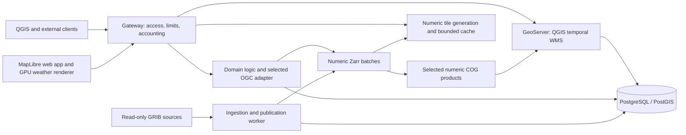

# Hydrometcenter meteorology prototype — specification

Version: 0.8 · 2026-10-29 · **Accepted implementation handoff.**

The user accepted revision 0.2, milestones M1–M5 and acceptance criteria A1–A12 on 2026-10-19, then requested this browser-delivery amendment and the corresponding specification/ticket updates. Revision 0.3 preserves those IDs and extends their obligations to numeric display tiles and browser GPU rendering. Acceptance records scope agreement, not completion of the new gates.

Revision 0.3 makes numeric data tiles and browser GPU rendering the primary web weather-display path. GeoServer temporal WMS remains required for QGIS. The Zarr core, point/EDR contract, interaction rules and Martin deferral remain accepted. [Ticket #15](https://github.com/stepanosokin/hmc-app-prototype/issues/15) selected the narrow numerical HTTP adapter for the measured point/metadata workload; tile encoding, tiling engine and GPU performance require separate evidence. See [ADR 0002](../../docs/adr/0002-numeric-browser-tiles.md).

Revision 0.4 adds the user-approved optional TLS capability in section 10.1 and T21 / #33. It preserves M1–M5/A1–A12; TLS implementation and operational activation remain unverified.

Revision 0.5 records the user-confirmed Windy design concept in section 9.1 and [T22 / #34](https://github.com/stepanosokin/hmc-app-prototype/issues/34). All Q1–Q8 decisions and the shared understanding were explicitly confirmed on 2026-10-20. It preserves functional scope and M1–M5/A1–A12; the base mockup is now visually approved and #34 closed, while real viewer validation remains pending.

Revision 0.6 records the confirmed web-map-only projection requirements in section 9.2: Mercator, strict orthographic globe and fixed EPSG:3576. T23 / #35 establishes technical feasibility before T24 / #36 extends the approved base mockup and #25/#27 implement the viewer. M1–M5/A1–A12 retain their IDs; new implementation criteria remain unverified.

[Russian copy](spec.ru.md) · [Decision map](map.md) · [Domain glossary](../../GLOSSARY.md)

T23a / [#37](https://github.com/stepanosokin/hmc-app-prototype/issues/37) amendment,
explicitly approved on 2026-10-20: implement the versioned
[`hmc-native-display/1`](../../publication/native-display.v1.json) candidate
alongside frozen `hmc-temperature-tile/2`. Deliver native float32 cells, validity
masks and one-cell halos for a single GPU bilinear interpolation; compare with
bounded server display derivatives using independent raw-GRIB values at identical
geographic points. The [approved design](../../docs/design/t23a-native-display-draft.md)
defines URL, matrix/CRS, height-zero operation, immutable cache identity and resource
limits. Point/EDR remain canonical nearest-native-cell. This technical experiment
does not establish rotating-globe or physical Android/iOS acceptance; T23 and the
production viewer gates retain those obligations. M1–M5/A1–A12 are unchanged.

Revision 0.7 records the user-confirmed stable time navigation and real forecast point series in section 9.3. Q1–Q9 and shared understanding were confirmed on 2026-10-21. Map preservation, immediate ready-grid replacement and point graphs are new unverified obligations; M1–M5/A1–A12 and historical completion states remain unchanged.

## 1. Purpose and scope

Build a self-hosted meteorology prototype that proves ingestion of the supplied GRIB2 file, numerical normalization, web-map publication and authenticated external access from QGIS. The product has a Russian interface and UTC timestamps. This document is the current implementation contract; completed planning and local numerical checks do not establish deployed-stack readiness.

The first release includes the sample's available temperature field and forecast times, numeric display tiles and a responsive GPU-rendered map with legend/time controls/value inspection, documented APIs, organization keys/limits/usage records, incremental publication, retention and operational diagnostics. It establishes interfaces for later imagery, observations, hydrology and long-term forecasts.

Native mobile, production integration of tens of sources, live database connections, wind particles, numerical raster downloads, payments, tariffs and Martin/vector layers are deferred. Numeric display tiles are in scope; the deferred numerical raster downloads refer to bulk analytical coverage exports. A future module need not use the meteorology storage formats.

## 2. Evidence and planning envelope

| Item | Requirement or evidence |
| --- | --- |
| Input | `data/grib/ICON_EU_T_G_2026101500.grib2`, 26,658,586 bytes |
| Preliminary inventory | 24 messages; reference time 2026-10-15 00:00 UTC; hourly leads +1…+24; 1377 × 657 regular geographic grid |
| Field identity | Parameter codes 0/0/0; encoded surface type 1. Verify as surface temperature; do not label it 2 m air temperature. |
| Decoder gate | Packing template 5.42 requires successful CCSDS decoding with the selected AEC-enabled ecCodes build. |
| Wider workload | Tens of models; individual files up to several GB; some source updates every 15 minutes, others hourly |
| Audience | Fewer than 100 concurrent users is a planning estimate, not demonstrated capacity. |
| Retention | Initially seven days by model-run reference time; configurable toward 30 days |
| Hosting | One organization-controlled Linux server, Docker Compose, self-hosted runtime; internet available for setup |

Local [T1 decoder](../../docs/decoder.md), [T2 storage](../../docs/storage.md) and [T3 adapter](../../docs/validation/archives.md) evidence now exists for the supplied sample. T2 covers Zarr/COG precision; its A2 evidence does not cover the new tile encoding/resampling checks. T3 covers point/metadata operations on the approved workstation, with no numeric-tile or GPU benchmark. Real publication/QGIS and full-stack gates remain open. Update frequency does not by itself establish the number of distinct model runs. Server sizing is explicitly deferred. See [sample inventory](assets/sample-inventory.md).

## 3. Architecture and responsibilities

| Compose responsibility | Implementation direction |
| --- | --- |
| Edge | TLS/reverse proxy, public/protected routing, request identification, authentication/limits/accounting before protected cache access |
| Web | Russian TypeScript/MapLibre application; numeric tile decoding, GPU textures and scalar weather rendering; locally served runtime assets |
| API | Domain catalogue, availability, selection and organization access; selected narrow numerical adapter; versioned numeric tile metadata/delivery |
| Worker | Source inventory, decoding, normalization, derivatives, validation, publication, retries and cleanup; durable jobs in PostgreSQL |
| GIS | GeoServer/ImageMosaic temporal WMS for QGIS and other image clients, with bounded portrayal cache |
| Database | PostgreSQL/PostGIS metadata, manifests, jobs, consumer/key records and usage; separate application and mosaic schemas/roles |

The API and worker share domain code and product identifiers; they can use the same image with different commands. No separate service per subject-area module is required. Initial deployment does not require Kubernetes, public cloud storage, a distributed queue or a standalone Martin container. Exact image/library versions are locked during the compatibility milestone.

Numeric tiling can share the existing API/worker image and domain resolver; a standalone tiling service is optional. Compare reuse of GeoServer for the numeric tile requirements, an existing numeric-tiling toolkit and a small project implementation in #16. Select on proven encoding, mask, projection, revision and browser-cost requirements; reuse of GeoServer is preferred where it meets the contract without lossy colour-only output. The browser GPU layer applies the palette to decoded values. Precoloured WMS/image tiles remain the GIS portrayal path and a benchmark baseline; a browser fallback needs an explicit supported contract.

### 3.1. OGC API alternatives and selection gate

No evidence establishes pygeoapi as the most efficient server for this workload. Existing Zarr/EDR support makes it a relevant integration candidate; efficiency includes response latency, successful throughput, CPU/RAM/I/O, publication refresh and maintenance effort. Feature-serving benchmarks do not rank numerical array adapters.

| Candidate | Relevant strengths | Fit/limitations for this prototype |
| --- | --- | --- |
| pygeoapi | Existing Zarr/NetCDF Xarray EDR Position/Cube providers; broad standard adapters | Numerical shortlist; forecast run/revision integration remains custom and stock Instances support is absent. No performance win established. |
| ldproxy | Features/CRS/filtering/Tiles and PostGIS schema mapping | Future feature-service candidate; direct Zarr/EDR serving was not established in its documented provider inventory. |
| GeoServer OGC APIs | Reuse already-planned GIS server and feature catalogue | Features extension has documented tested Core/CRS support. Separate Maps/Tiles/Coverages modules have different maturity/implementation limits; do not equate them with mature WMS. No direct Zarr EDR path established. |
| TiPG | Focused Features/Tiles over PostGIS and SQL functions | Future vector candidate; documented Features CRS Part 2 gap and no direct Zarr EDR path. |
| pg_featureserv | Focused SQL/table/function feature service | Future narrow PostGIS candidate; not the numerical array or temporal raster service. |
| Narrow Xarray/HTTP adapter | Direct access to the same domain sampling implementation and precise forecast behavior | Numerical comparator; project owns its OGC resources, schemas, encodings, errors and conformance work. |

See the [primary-source comparison](../../docs/research/ogc-api-alternatives.md), [pygeoapi EDR matrix](https://docs.pygeoapi.io/en/stable/publishing/ogcapi-edr.html), [ldproxy specifications](https://docs.ldproxy.net/references/specifications), [GeoServer Features status](https://docs.geoserver.org/stable/en/user/services/features/status/) and [TiPG implementation matrix](https://developmentseed.org/tipg/). Pin a released implementation and matching documentation during M1; moving documentation and beta modules are not deployment evidence.

Accepted M1 gate: compare pygeoapi with a narrow adapter calling the **same** manifest-backed Zarr sampling function. Require equal values/masks, exact time/run/revision, unavailable-data handling, output meaning and gateway policy before comparing speed. Fix the host/container budgets, dependency versions, data hashes, chunking, request mix and worker counts; separate cold/warm caches and repeat measurements. Measure point/metadata operations required now; use time-series/cube queries only as explicitly labelled future-workload experiments. Report p50/p95/p99, successful throughput, errors, CPU/RSS/I/O, bytes, publication freshness and custom integration work. Agree resource/latency thresholds for the measurement host before declaring a winner; do not infer a production SLA from the sample.

Select one numerical adapter before freezing M3 implementation; do not ship all candidates. Reuse GeoServer for temporal WMS. Compare feature-service candidates only when representative vector schemas/data become available. This preserves one external contract and permits different engines for different operations.

M1 result: [ADR 0001](../../docs/adr/0001-numerical-http-adapter.md) and [T3 evidence](../../docs/validation/archives.md) select the narrow adapter for bounded point/metadata work. The comparison above is the retained selection method. It neither ranks tile engines nor proves broader OGC conformance; pygeoapi can be reconsidered independently for a later standards profile.

## 4. Data identity and ingestion

Identify every field by provider/model, reference time, parameter/table identifiers, surface/level or layer bounds, grid, member where applicable, valid time or interval, and source revision. Preserve statistical processing semantics for future accumulated/averaged products. File, model run and valid time are different concepts.

Source adapters expose local/read-only mounted paths now; file-server protocol and credentials are configured when access is supplied. Detect completed files using a producer manifest/atomic-delivery signal when available. Otherwise use a documented stability delay plus structural validation/retry, acknowledging that stability alone cannot prove producer completeness. Partial/truncated/unsupported files are quarantined.

Use source checksum and pipeline version for idempotence. Preserve original bytes in managed storage if continued retrievability on the source server is not guaranteed. Record provenance and decoder/definition versions. Process bounded compatible batches instead of assuming a GB-scale file can be loaded in full without resource limits.

## 5. Hybrid storage and selected map products

Zarr is the normalized numerical core. Start the compatibility exercise with explicit Zarr format 2 and lossless encoding; pin the tested writer/reader/codecs rather than relying on package defaults. Preserve coordinates, units, masks and GRIB metadata. A provider resolves a published manifest into the required field/time view.

Use immutable batches per available field/time group, partitioned by compatible grid/level structure. A small immutable run manifest reuses unchanged batches; late/corrected data create replacement batches and a new revision. Do not copy the entire growing run for every publication. Compaction of sealed runs is a later measured optimization, with old references retained until safe to remove.

Publication profiles configure the fields/levels normalized and the subset exposed as map products. For the sample, ingest all 24 messages and publish every successfully validated time of its sole field. Generate numeric COGs **from those Zarr batches**, with lossless encoding, masks and overviews. Keep native-grid numerical identity; GeoServer handles WMS reprojection, while numeric tiles declare their own projection/resampling. Display overviews and GPU-interpolated values are not the source for canonical point values.

The prototype must prove numerical round trips against the ecCodes baseline. Preserve finite values and masks in the Zarr core. Any COG dtype conversion needs a recorded variable-specific tolerance; for the sample temperature, use a maximum absolute conversion error of 0.0001 K as the initial engineering acceptance bound. A failing bound blocks publication. Validate cell centres, scanning direction, longitude normalization and half-cell georeferencing explicitly.

The hybrid adds derivative CPU/storage and publication coordination. No storage or speed advantage has been established. Later chunk/pyramid choices require measurements.

### 5.1. Numeric display tile contract

Derive display tiles from manifest-selected Zarr values, directly or through a validated numeric derivative. Before finalizing the tiler, compare float-array and packed-value encodings with actual browser decode/upload measurements. Freeze versioned metadata, URL template/content type, matrix set/CRS, zoom range, tile dimensions/origin/orientation, bands, dtype/byte order or scale/offset, units, compression, nodata mask and resampling/halo rules. Ordinary precoloured images cannot substitute for numeric values. No tile encoding or URL shape is selected by this specification.

Agree variable-specific display error budgets before selecting an encoding: test decoded values against the canonical baseline after the declared resampling, including quantization and GPU interpolation. Keep the existing 0.0001 K COG conversion bound separate. Validate source-sphere/geographic-to-map projection, cell placement, coverage edges, tile seams/halos and missing-data masks. Display interpolation has documented semantics; point and EDR remain exact-time/nearest-native-cell queries. CoverageJSON is the position-response encoding, not the browser tile protocol.

## 6. Publication and failure behavior

Lifecycle: `discovered → staged → decoded → normalized → derivatives_ready → validated → published`; failed stages retain diagnostics and support retry. Track progress per field/time. Run completeness is separate from usability: one validated map-ready time is enough to make a partial run usable. Without an expected producer inventory, completeness is unknown rather than inferred.

A shared published revision becomes visible only when the required Zarr batch, COG, numeric tile path/metadata and GIS selection are durable, validated and queryable. Define tile readiness explicitly for eager or lazy generation and exercise deterministic representative requests before visibility; generating every possible tile in advance is not required. Keep internal staging and GeoServer administrative routes private. Constrain all public capabilities/map/identify/tile/numeric requests to the selected manifest. A PostgreSQL transaction alone does not synchronize independent GeoServer index changes: the integration milestone must prove the visibility gate and revision-filtered granule selection, including discovery metadata.

Publish new validated times incrementally. Readers pin run and revision; corrections never overwrite assets referenced by a published revision. Numeric tile cache identities include run/revision, field, level, exact time, grid/member, matrix set/coordinates, resampling and encoding version. Palette changes operate locally without refetching unchanged numeric tiles. Style/shader versions belong in rendered-product identities rather than invalidating the underlying numeric bytes. New run arrival and new revision availability do not silently change the user's selection.

Derivative/indexing failure leaves the previous usable revision intact. Recovery after worker restart must be idempotent; abandoned stages are collectable. Use bounded jobs, concurrency, retries and disk/cache budgets.

## 7. API and GIS contract

The following contract is independent of the OGC server selected through M1. Domain logic resolves explicit run/revision/time selection before reading normalized data. If pygeoapi is chosen, its stock Zarr EDR provider still needs custom provider/routing integration; if the narrow adapter is chosen, the project must implement the advertised OGC profile explicitly. Use `run` and `revision` as documented query extensions to the initial EDR profile; do not claim standard Instances support without implementing it.

| Interface | Initial contract |
| --- | --- |
| `/ogc/collections` and collection metadata | Discover approved public products and available query/portrayal links |
| `/ogc/collections/{collectionId}/position` | EDR position query with `coords`, `datetime`, `parameter-name`, and explicit `run`/`revision`; CoverageJSON response |
| `/api/v1/modules`, `/api/v1/models`, model/run/revision listings | Domain catalogue and availability; actual identifiers and available dimensions |
| `/api/v1/point` | Convenient documented numerical query using layer/run/revision/valid_time/lon/lat; same resolver as EDR |
| `/gis/v1/runs/{runId}/revisions/{revision}/wms` | Gateway-scoped WMS 1.3.0 connection for the selected run/revision; capabilities, map, legend and identify |
| Browser numeric tile links and metadata from catalogue | Stable published selection; versioned encoding/matrix/mask/resampling contract and cacheable numeric values for GPU rendering |

Coordinates in the domain point API are named longitude/latitude in degrees. EDR follows the advertised CRS/profile. WMS follows its version/CRS axis rules; do not reuse one ordering blindly across interfaces. A point response reports selection identity, selected native-cell coordinate, units, sampling method, value or explicit no-data reason, and provenance. Default spatial sampling is nearest native cell; temporal selection is exact.

For the domain API, distinguish invalid input (400), credentials (401/403), unavailable selection (404), expired retained data (410), limits (429), and transient processing/service failure (503). A valid location with no coverage/nodata returns an explicit null result and reason, never an edge-cell substitution. OGC endpoints use their documented exception/response profiles. Missing requested times never choose a nearest time or another run. Publish OpenAPI and runnable examples; pin the supported QGIS version during integration.

QGIS must connect with an organization key header, select available times, render the same field and inspect values consistent with the numerical baseline. The scoped WMS URL makes run/revision choice explicit; its advertised links and time domain must retain that scope. Validate EPSG:4326 and EPSG:3857, masks, legends and full-resolution identify. Do not claim general OGC conformance from product installation alone.

Numeric browser tiles use a documented versioned HTTP contract and do not by themselves establish OGC API Tiles conformance. OGC API Tiles/Maps facades can be enabled after dimension forwarding and the applicable profile are proved. Coverage downloads and broader EDR queries are deferred. Martin is reserved for later feature layers; scientific U/V fields and dense scalar arrays are not automatically MVT products.

## 8. Access, usage and future billing

The demo map is public and uses no organization secret. External organizational API/GIS access uses independently revocable keys, organization-level limits and usage records. Check credentials and quotas before protected cache delivery; prevent direct backend or asset routes bypassing that contract. Public demo access has separate resource limits.

Provide operator commands to create/revoke/rotate keys and configure limits; an administration portal is unnecessary for this milestone. Bound rendering dimensions, numeric tile zoom ranges/bytes, tile generation and concurrent requests, request duration, cache growth and output size as well as request rate. Store protected key representations, not recoverable raw keys in logs. Record request ID, organization/key ID, operation, selected product/run/revision, UTC time, status, duration, bytes and cache outcome where available. Include cache hits and rejected requests; document retry/accounting behavior. Payments, monetary calculation and tariff policy are not implemented. Public data remain publicly viewable regardless of future API charging policy.

## 9. Web experience

Use Russian labels, UTC timestamps, a full-screen map, compact model/field/run controls, bottom time bar, stable product legend and point card. Small screens use a collapsible control sheet without losing run/time context. Show only implemented modules/products. Include source attribution, data age, reference time, valid time, availability and completeness/unknown status.

Default to the newest usable run and its first available time. Selecting another run starts at its first available time. Keep run and revision fixed while navigating; unavailable times are marked and selecting one clears the layer/value. New data produce a notification; switching runs or refreshing availability is explicit. Changing time/run clears stale point results, and late responses for an earlier selection are discarded.

Differentiate loading, missing time, outside coverage, native nodata and service error. Update failure retains the last published data. Initial styles cover the actual surface-temperature field; no wind animation or fabricated observation layer appears. Basemap/style/font resources are locally served with attribution and verified redistribution rights; a simple regional basemap is sufficient for the first release.

Render the scalar temperature overlay with numeric tile textures in a MapLibre GPU layer. Keep units, colour scale and legend consistent; handle masks without colour leakage at nodata edges or tile seams. Cap tile prefetch/cache, decoded arrays and GPU textures; cancel obsolete fetches, reject stale results before texture upload and release superseded resources, including context-loss recovery. Detect required GPU capabilities and provide a documented supported fallback or a clear unavailable-renderer message; silent blank output is unacceptable. Palette changes must not fetch unchanged numeric data. Do not blend across missing times, runs or revisions; temporal blending and wind particles remain deferred. The sample provides no U/V field.

### 9.1. Windy visual concept — v0.5

[Windy.com](https://www.windy.com/) is the accepted reference for layout and interface density. Use Hydrometcenter's own colours and identity, compact buttons and translucent panels, Russian controls/states/messages and UTC timestamps. The reference does not expand the accepted feature set: the first release shows the actual available temperature field; wind particles, temporal blending and other deferred products remain deferred. The [confirmed concept](../../docs/prototypes/design-concept.ru.md) records Q1–Q8; the earlier illustrative HTML remains an interaction artifact, not the agreed visual design.

- The map fills the viewport with compact controls over it. On desktop, model/field/run controls sit at the upper left, layer selection on the right, the time bar at the bottom and the stable legend on the right above that bar. A selected point's value appears beside its marker.
- Initially fit the full coverage of the available forecast. A Russian-labelled “К области данных” control returns to that extent. Keep the existing newest-usable-run/first-available-time default; this spatial choice does not change the pinned selection or missing-time behavior.
- Keep reference time and valid time in UTC visible at all times. Source/publication details expand separately; retain the existing attribution, age, availability and completeness requirements.
- On a phone, use one bottom sheet, initially collapsed. A map tap opens point details to half the screen; settings use that same sheet. The time bar and selected time remain accessible, and run/time context is preserved.
- Use dark translucent panels, light text, a quiet basemap and a distinct temperature colour scale consistent with the legend. Exact shades, dimensions, opacity and readability are assessed on the visual mockup.
- [T22 / #34](https://github.com/stepanosokin/hmc-app-prototype/issues/34) delivers an interactive desktop/phone HTML mockup with Russian labels and explicitly marked demonstration data, before connecting real data. Record visible interaction checks, desktop/phone captures and the user's visual approval. The base T22 mockup was approved and #34 closed on 2026-10-20; its historical evidence remains unchanged. T24 / #36 extends it after T23 / #35.

The approved mockup guides #25's production viewer and #27's responsive controls; those tickets must retain their actual-sample, numerical/GPU and Compose acceptance gates. A demonstration mockup cannot establish A2/A3/A8/A11 or replace real browser/GIS evidence. Basemap/style/font assets remain subject to local serving, attribution and redistribution requirements; the design reference does not imply reuse of Windy's assets or services.

### 9.2. Web-map display projections — v0.6

The user confirmed Q1–Q9 and shared understanding on 2026-10-20. See [ADR 0003](../../docs/adr/0003-web-map-display-projections.md). The choice changes only web-map display: source/native storage and canonical point/EDR semantics remain intact, and external WMS/QGIS still requires EPSG:4326/3857 rather than additional CRS support.

- Offer Russian-labelled Web Mercator (EPSG:3857), a rotating and zoomable strictly orthographic globe, and fixed EPSG:3576 (WGS 84 / North Pole LAEA Russia). Fix LAEA at latitude of origin 90°N, longitude of origin 90°E, zero false easting/northing and WGS84, in metres; no user-controlled LAEA centre in this version.
- Restrict LAEA display to latitude 45°N and northward, explicitly explain the restriction and keep the southern forecast available in the other modes. This is a display-domain restriction, not native nodata or loss of source coverage.
- Every page opening starts in Mercator and fits the entire available forecast coverage; do not remember the last projection. “К области данных” fits the coverage visible in the current mode without changing the forecast selection.
- Switching keeps run/revision/time/units and the selected geographic point. Preserve centre and comparable geographic extent where feasible; numeric zoom levels need not match between projections. Hide a point marker beyond the globe horizon or outside the LAEA domain, retain its selection and explain this state in Russian. Existing run/time-change invalidation rules remain in force.
- Align weather values/masks, local basemap, labels, coverage geometry, marker and inverse screen picking in every mode. Canonical click values come from the point API after coordinate conversion; never infer values from displayed colours. Reject clicks on the globe background or outside the mode's display domain.
- Detect unavailable modes, show a Russian explanation and offer an explicit switch to Mercator. Do not silently substitute a perspective globe or automatically change modes; retain the existing GPU context-loss/resource/error requirements.
- Server-derived display tiles, including EPSG:3576, are permitted if needed. Select browser reprojection versus server derivatives from evidence. Preserve frozen contract v2 and historical evidence; any new contract must explicitly distinguish version/matrix/CRS and grid parameters in metadata, URLs and cache identity, preserve selection/availability/access/budgets/retention, and verify readiness and relevant regression gates before production use. No new standalone service is required by this decision.
- First complete [T23 / #35](https://github.com/stepanosokin/hmc-app-prototype/issues/35): real gateway/Compose numeric tiles, strict orthographic geometry, EPSG:3576, local basemap, independent value/placement/mask/seam checks, inverse picking and desktop/mobile costs. Preserve total display error ≤0.01 K and encoding error ≤0.001 K, including additional interpolation, separately from the ≤0.0001 K COG bound and the existing prototype datum hypothesis. Add explicitly labelled synthetic polar/antimeridian/horizon cases where the real European sample is insufficient. Proven incompatibility requires revisiting the decision, not silently replacing MapLibre or orthography.
- Then complete [T24 / #36](https://github.com/stepanosokin/hmc-app-prototype/issues/36), a separately archived extension of the approved T22 mockup, with new visual approval; then implement #25/#27. If T23 establishes necessary server changes, create a linked implementation ticket and complete it before production viewer acceptance. #28 verifies local runtime resources in every mode, #31 measures each mode and switching, and #32 indexes final evidence. Keep #16/#22/#23/#24/#34 closed unless a defect in their accepted scope is independently established.

M1–M5 and A1–A12 retain their IDs. This amendment extends A2/A3 numerical and picking checks, A5/A8 switching/race/resource/UI behavior, A11 local resources and A12 measurements to all modes; A6/A7/A9 apply to any new server derivatives. Agreement and technical/mockup results alone do not complete production acceptance.

### 9.3. Stable time navigation and forecast point series — v0.7

The user confirmed Q1–Q9 and shared understanding on 2026-10-21; see the
[decision record](time-navigation-graph-discussion.md). These are new, unverified
implementation requirements. Preserve M1–M5/A1–A12 and historical completed
tickets/evidence; this amendment extends A3/A5/A8/A12, without claiming completion.

**Stable map.** Changing valid time through the slider, time controls or graph
updates only the thematic coverage and related time/value/loading metadata (and
legend when required). Keep the existing Map, basemap, labels, projection,
geographic camera/scale, selected point and control-sheet context. Do not recreate
the map, reload unchanged basemap resources because of the time change, or fit
coverage again. Point coordinates remain selected; stale point numbers are cleared.

**Immediate grid replacement.** Selecting a valid time changes the thematic grid
without recreating the map. The previous complete frame stays visible until the
new complete frame is ready and is then replaced immediately and atomically,
without animation, interpolation, cross-fade or empty/partial flashes. Displayed
and requested times remain distinct; the latest selection wins and obsolete
responses, decoded arrays and GPU uploads are rejected. Run/revision, masks,
display-error budgets and canonical sampling semantics remain unchanged.
Showing intermediate times during slider dragging is not required. Immediate
replacement describes a ready frame, not zero network/decode/upload latency.

**Missing and failed times.** Selecting a missing time immediately removes the
thematic frame and point number, retaining map, point coordinates and an explicit
Russian explanation. A failed load of an available time may retain the preceding
complete frame only with its actual time and a visible error; it does not complete
the requested selection. Outside coverage, native nodata, missing time and request
failure remain distinct. An expired publication prompts explicit reselection;
caches must not restore an expired frame or silently change run/revision.

**Real graph in the point card.** Show the entire published forecast for the
selected point and field within one pinned run/revision, using canonical
exact-time/nearest-native-cell values, UTC and the current units. Highlight the
selected time; when a previous map frame is retained, identify its different
displayed time explicitly. Do not derive values from map colours, temporal
interpolation or synthetic mockup data. Historical observations remain out of
scope. Missing values and failed requests create breaks in the line with distinct
states; retain successful parts on partial failure and allow retry of failed
requests. Never show an earlier point/run/revision's series as the new series.
Changing only the selected time reuses the unchanged series and moves its
highlight; changing point, field, run or explicitly accepted revision refreshes
the series. Preserve availability, expiry, access and bounded request/cache rules;
no particular endpoint or broader EDR conformance is selected by this requirement.

**Graph interaction and mobile.** Provide UTC/value tooltips through mouse, touch
and keyboard. Explicit selection on the graph selects the same time in the slider
and map, including the defined missing-time behavior; hover alone changes no time.
On phones the graph lives in the shared sheet's “Точка” tab, fits the panel width
and does not cover the time bar. Preserve point/sheet context during time changes.

**Validation and bounded resources.** Bound managed field arrays, cached frames,
textures and framebuffers together to 128 MiB. Verify Chrome and Edge desktop
and physical Chrome/Android in Mercator, strict orthographic and EPSG:3576;
emulation does not replace the physical device. Safari/iOS remains unverified.
T26 / #40 was cancelled by the owner on 2026-10-22: slider feedback within
100 ms, prepared-frame p95 within 100 ms and cold loading within 3 s are no
longer acceptance targets. General workload measurements remain in #31.

New requirements remain unchecked until actual implementation and validation:

- [ ] Time changes preserve map/basemap/camera/point and update only thematic data.
- [ ] Ready grid frames replace the previous frame immediately, without blank flashes, animation or stale completion.
- [ ] Loading, missing time, failure, nodata and expiry preserve the specified identities/states.
- [ ] The real canonical forecast graph covers the pinned series, gaps, partial failure and reuse/invalidation.
- [ ] Graph selection, tooltips, keyboard/touch and phone layout agree with map/slider state.
- [ ] Reproducible desktop/physical Android evidence verifies all three projections and the memory bound.

### 9.4. Native field contours and display units — v0.8

The owner approved implementation on 2026-10-29 in [#74](https://github.com/stepanosokin/hmc-app-prototype/issues/74).
The [accepted requirements and normative 29-field interval table](../../docs/design/field-contours-discussion.md)
fix every small/medium/large-scale interval, including custom surface-pressure
25/20/5 hPa and visibility 20000/10000/5000 m. Width classes are >6000 km,
>2000 and <=6000 km, and <=2000 km, consistently evaluated across all four views.

Build contours in a bounded background browser worker from native Zarr-cell
values and numerical NoData masks delivered through the numerical service,
under the declared native encoding error. Do not extract geometry from raster
pixels, palette, transparency or screen-resampled values. Preserve valid zeros,
block seams, selection identity, cancellation and the shared 128 MiB resource budget.
Cache bounded results; local runtime dependencies and real-field performance
measurements are required. No new latency SLA is implied.

Overlay black contours in dark mode and #707070 grey in light mode; break lines
under labels and orient the top of each label towards increasing values even
when upside down. Place at most seven labels in the visible map. Hide components
shorter than 60 screen pixels; total simplification and smoothing displacement
is <=1 screen pixel. Do not smooth the numerical field. State the interval in
the legend. The global toggle starts enabled on every page opening, hides lines
and labels together, and is not persisted. Manual in-app interval entry is out
of this agreed scope; custom design settings were supplied in chat.

Display pressure in hPa throughout the UI, specific humidity in g/kg, snow depth
in cm and unambiguous precipitation rates in mm/h. Keep source, Zarr, numerical
API and GIS units unchanged. Four diagnostic fields use the selected intervals
of original numbers with explicit undefined/contradictory-unit legend notes;
do not silently convert contradictory accumulated rain-rate fields to mm/h.
This extends A2/A3/A5/A8/A11/A12, preserving existing IDs and completion states.
Implementation and scientific/real-browser evidence are required before closure.

## 10. Retention and operations

Retain runs whose reference times are within the last seven days, including all their published forecast times even when valid times extend beyond that window. Configure the duration toward 30 days without changing identifiers. Retention is for application-managed originals/copies, Zarr batches, COGs, numeric tile products/metadata, manifests and server caches; organization source mounts are never cleanup targets.

Expire discovery/access first; remove unreferenced assets after bounded in-flight-reader grace. Superseded revisions have a configurable grace/budget; sessions cannot pin files forever. Bound server cache lifetimes by eligibility. Browser HTTP/decoded/GPU caches must discard expired or superseded selections according to the documented policy; reusing a texture cannot resurrect an expired publication. Expired selections return a clear response and prompt reselection. Provide cleanup dry-run and usage reporting. Pin the historical sample in demo mode or use a fixed demonstration clock.

Persist database and products on explicit volumes. Configure secrets outside committed data/config; mount reader assets read-only where possible. Define source readiness, worker/API/database/GIS health, structured logs, job backlog, publication lag, failures, storage and cache use. Back up the catalogue/config/key metadata and document recovery from retained sources; usage retention is separately configurable. Offline runtime must not require public basemap/API calls. Host sizing, public DNS and organization certificate/key provisioning remain deployment inputs. Implementing configurable TLS is a separate obligation under section 10.1, not completed work.

### 10.1. Optional TLS with organization-provided certificates — v0.4

The user accepted this amendment on 2026-10-20. [T21 / #33](https://github.com/stepanosokin/hmc-app-prototype/issues/33) implements an opt-in HTTPS reverse proxy in front of the existing gateway for the website, numerical API, tiles and GIS. Local HTTP development remains usable without certificates. Once the organization supplies its server certificate, trust chain and matching private key, an operator enables TLS through deployment configuration without application-code changes or rebuilding the application. Providing real organization certificates is not a prerequisite for implementing or testing this capability.

Supply certificate/chain and key as external PEM files mounted read-only into the TLS proxy; keep them outside Git, images, web assets, logs and portable evidence. TLS private keys and organization API access keys are distinct secrets. Document server name, external HTTPS origin, ports, file paths and client CA trust. In TLS mode only the HTTPS edge exposes protected services externally; plain HTTP must not serve protected requests. Redirecting a request cannot protect credentials already sent over HTTP. Preserve the gateway access policy, internal backend isolation, /org profile and run/revision scope. Catalogue, tile metadata and WMS capabilities links must retain the external HTTPS origin without mixed content; arbitrary client forwarding headers must not control that origin or bypass policy.

Document certificate replacement with configuration validation and controlled reload/restart, verification and recovery of the previous configuration. Missing, unreadable or mismatched certificate/key files must produce a clear startup/configuration error without automatic fallback to exposed HTTP. Validate the real proxy/gateway using a test CA and hostname-valid certificate with certificate verification enabled: trusted chain/name, wrong name/untrusted CA rejection, public/protected API/tiles/WMS, external links, warm-cache authorization/revocation, backend isolation, certificate replacement and failure behavior. Reuse the actual-sample access/publication gates for affected components, archive evidence without private keys and retire all test resources under the development workflow.

This gate proves TLS readiness using test certificates. Organization DNS, real certificate/key/chain installation and target-host/client trust verification remain operational rollout inputs. Automatic certificate issuance/renewal (ACME), mutual TLS and replacement of existing API-key authentication are outside T21. Full desktop QGIS acceptance remains in its existing GIS task.

## 11. Implementation sequence

| Milestone | Deliverable and exit gate |
| --- | --- |
| M1 — Decode, compatibility and API comparison | Reproducible tools; all sample messages decoded; field/units/grid/masks and numeric round trip validated; locked storage readers; evidence-based numerical adapter choice under section 3.1 |
| M2 — Publication core | Durable jobs, immutable batches/manifests, COG and numeric tile readiness/contract, idempotent retries and retention; prove failed updates preserve previous data |
| M3 — GIS and API | GeoServer selection/visibility gate, scoped QGIS WMS, selected OGC adapter discovery/position, domain catalogue/point and numeric tile delivery; consistent selection and protected caches |
| M4 — Web map | Russian MapLibre GPU scalar viewer, validated numeric decoding/masks/seams, accepted selection/UTC/legend/click behavior, responsive controls and local runtime assets |
| M5 — Operational handoff | Keys/limits/usage, optional TLS readiness under T21, restart/cleanup/recovery exercises, documentation and concurrent server/tile/browser-GPU measurements against agreed targets |

Do not hide failed compatibility gates behind mock data or silently replace the selected architecture. Record evidence and revisit the affected decision if the chosen products cannot satisfy it.

## 12. Acceptance and measurement

| ID | Required evidence during implementation |
| --- | --- |
| A1 | All 24 sample messages decode; identities, times, surface, units, masks and coordinate placement are recorded and checked. |
| A2 | Zarr and COG precision/mask evidence is retained; numeric tile encode/decode, declared resampling and GPU interpolation pass separately agreed display error budgets at representative cells, coverage edges and tile seams. |
| A3 | Browser tiles/GPU, domain point, EDR position and QGIS use identical run/revision/time/field. Compare decoded display values under declared resampling/tolerances with the canonical baseline; canonical click values come from the point API, never inferred from colours. |
| A4 | QGIS capabilities/time/legend/identify work with credentials in the pinned client version and both stated CRSs. |
| A5 | Labelled fixtures exercise overlapping runs, missing times, late/corrected batches and old-revision readers without mixing, including delayed tile fetch/decode/upload during navigation and explicit updates. |
| A6 | Crash/retry, numeric tile generation/metadata readiness and GIS derivative/indexing failures never expose unfinished selections or replace the last usable publication. |
| A7 | Public/protected numerical, tile-metadata/tile and GIS routes exercise invalid/revoked keys, limits, warm cache hits, expiry, bypass prevention and usage records. |
| A8 | Russian UI/UTC, section 9.1's accepted Windy layout/mobile behavior and visually approved T22 mockup, GPU-rendered scalar values/masks/legend, loading/errors/nodata, stale point/tile rejection, bounded resource lifecycle and explicit GPU capability/context-loss behavior match the contract. Mockup evidence alone does not establish production behavior. |
| A9 | Seven-/30-day retention safely expires managed runs and numeric tile/metadata/server caches; browser caches cannot resurrect expired selections; source mounts and historical demo rules remain intact. |
| A10 | Compose startup/restart, persistent storage, health and recovery documentation work on the agreed Linux host; optional TLS enablement, certificate replacement and failure behavior pass section 10.1 using test certificates before organization credentials arrive. |
| A11 | Network and disconnected-public-runtime checks confirm locally served basemap/styles/fonts, shaders, decoders and any required WASM/workers; no mandatory public runtime service. |
| A12 | Report declared workload/hosts/browsers/configuration, preserved M1 point/metadata comparison, ingestion/publication/server metrics, cold/warm numeric tiles and image baseline, bytes, decode/upload time, frame-time/FPS, browser/GPU memory, cache/storage/errors/backlog. Agree server and desktop/mobile browser targets before readiness claims. |

Use the sample for correctness, then representative multi-GB/multivariable/model updates for sizing. Exercise cold/warm maps and clicks while ingesting, with configurable concurrency such as 1/10/50/100 clients. These are measurement profiles, not a guarantee that 100 clients meet an unspecified SLA. Compare seven- and 30-day storage envelopes and account for raw copies, Zarr, selected COGs/overviews, staging, old revisions and cache. The missing production volume/server envelope prevents a defensible capacity commitment today.

## 13. Extensions and unresolved inputs

Register each subject-area module's catalogue, source adapters, products/query capabilities and access policy through the common domain interfaces. GeoTIFF imagery can reuse selected raster publication; station/vector observations and future PostGIS hydrology can introduce OGC API Features and Martin tiles when sample schemas exist. Evaluate reuse of GeoServer Features, ldproxy, TiPG or pg_featureserv against those real schemas before adding another engine. Mobile clients reuse the versioned HTTP interfaces. Long-term forecasts may need different temporal/ensemble semantics; do not force them into a single deterministic forecast-run model.

Before operational rollout obtain representative datasets and schema/access details, producer completion conventions, true per-model run cadence/daily volume, target server/storage/network characteristics, the exact QGIS version, deployment DNS/TLS/secrets and agreed service targets. These are explicit implementation/operational inputs; source credentials must not be pasted into the specification. Full future-module contracts and billing policy are separate efforts.

## 14. Decision evidence

The [GitHub map](https://github.com/stepanosokin/hmc-app-prototype/issues/1) is the canonical tracker; the [local map](map.md) is a snapshot. Supporting investigations: [GRIB/storage](../../docs/research/grib-storage.md), [delivery standards](../../docs/research/delivery-standards.md), [Zarr comparison](../../docs/research/zarr-first-comparison.md), [pygeoapi/Martin](../../docs/research/pygeoapi-martin.md), and [OGC API alternatives](../../docs/research/ogc-api-alternatives.md). Provider-specific limits are documented in the official [pygeoapi EDR](https://docs.pygeoapi.io/en/stable/publishing/ogcapi-edr.html), [tile integration](https://docs.pygeoapi.io/en/stable/publishing/ogcapi-tiles.html) and [Martin COG](https://maplibre.org/martin/sources-cog-files/) references.

Completed planning and the reviewed interaction artifact are historical inputs. Local T1/T2/T3 reports validate sample decoding, Zarr/COG storage and the bounded numerical-adapter comparison. Numeric tiling/GPU rendering, real GIS publication/QGIS, broader external-profile validation and operational sizing remain implementation gates; this revision does not claim them complete.
