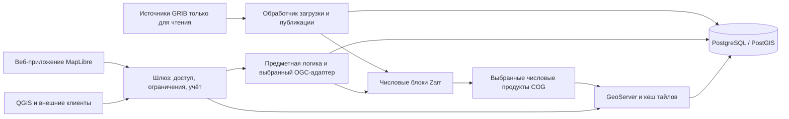

# Прототип метеорологического приложения Гидрометцентра — спецификация

Версия: 0.2 · 19.10.2026 · **Согласована для передачи в разработку.**

19.10.2026 пользователь согласовал редакцию 0.2, этапы M1–M5 и критерии приёмки A1–A12. Проверки этапа реализации ещё предстоит выполнить; согласование фиксирует принятие плана.

Редакция 0.2 учитывает запрос на сравнение OGC API. 19.10.2026 пользователь согласовал выбор числового адаптера через сравнительную проверку M1. Сам адаптер предстоит выбрать при реализации. Решения о хранении, QGIS, взаимодействии и отложенном Martin остаются согласованными.

[Английская версия](spec.md) · [Карта решений](map.md) · [Словарь предметной области](../../GLOSSARY.md)

## 1. Назначение и границы

Разработать самостоятельно размещаемый прототип метеорологического приложения, который демонстрирует загрузку предоставленного файла GRIB2, нормализацию числовых данных, публикацию на веб-карте и внешний доступ из QGIS с аутентификацией. Интерфейс приложения — русский, временные отметки — UTC. Этот документ предназначен для передачи в разработку; текущий этап wayfinder завершается материалами планирования, а не развёрнутым приложением.

Первый выпуск включает доступное в образце поле температуры и сроки прогноза, адаптивную карту с легендой, управлением временем и просмотром значений, документированные API, ключи организаций, ограничения и учёт обращений, поэтапную публикацию, хранение и эксплуатационную диагностику. Он формирует интерфейсы для последующего подключения снимков, наблюдений, гидрологии и долгосрочных прогнозов.

Нативное мобильное приложение, промышленное подключение десятков источников, рабочие соединения с внешними БД, анимация частиц ветра, выгрузка числовых растров, платежи, тарифы и слои Martin/векторных тайлов отложены. Будущие модули не обязаны использовать форматы хранения метеорологического модуля.

## 2. Исходные сведения и расчётные условия

| Позиция | Требование или имеющиеся сведения |
| --- | --- |
| Входные данные | `data/grib/ICON_EU_T_G_2026101500.grib2`, 26 658 586 байт |
| Предварительная опись | 24 сообщения; исходный срок расчёта 15.10.2026 00:00 UTC; заблаговременность +1…+24 часа с шагом час; регулярная географическая сетка 1377 × 657 |
| Идентификация поля | Коды параметра 0/0/0, тип поверхности 1. Подтвердить температуру поверхности; не обозначать как температуру воздуха на высоте 2 м. |
| Проверка декодера | Для шаблона упаковки 5.42 необходимо успешно декодировать CCSDS выбранной сборкой ecCodes с поддержкой AEC. |
| Общая нагрузка | Десятки моделей; отдельные файлы до нескольких ГБ; часть источников обновляется каждые 15 минут, часть — ежечасно |
| Аудитория | Менее 100 одновременных пользователей — оценка для планирования, а не подтверждённая производительность. |
| Глубина хранения | Первоначально семь суток по исходному сроку расчёта модели; настраиваемое увеличение до 30 суток |
| Размещение | Один Linux-сервер под управлением организации, Docker Compose, собственная инфраструктура во время работы; интернет доступен при установке |

Значения, единицы, маски, диапазоны и ориентация образца пока не декодированы и не проверены. Замеров производительности нет. Частота обновления сама по себе не определяет число отдельных расчётов модели. Подбор сервера явно отложен. См. [опись образца](assets/sample-inventory.md).

## 3. Архитектура и ответственность

| Ответственность в Compose | Предлагаемая реализация |
| --- | --- |
| Внешний шлюз | TLS/reverse proxy, публичные и защищённые маршруты, идентификация запросов, аутентификация, ограничения и учёт до выдачи ответа из защищённого кеша |
| Веб-интерфейс | Статическое русскоязычное приложение на TypeScript и MapLibre; стили, шрифты и картографическая подложка размещаются локально |
| API | Предметные каталог, доступность, выборка и доступ организаций; числовой стандартный адаптер выбирается через проверку M1 |
| Обработчик | Опись источников, декодирование, нормализация, производные продукты, проверка, публикация, повторы и очистка; задания сохраняются в PostgreSQL |
| Геосервис | Временной WMS GeoServer/ImageMosaic, растровая выдача для браузера и ограниченный кеш тайлов |
| База данных | Метаданные, манифесты, задания, записи потребителей/ключей и обращений в PostgreSQL/PostGIS; отдельные схемы и роли приложения и мозаичного индекса |

API и обработчик используют общую предметную логику и идентификаторы продуктов; допускается один образ с разными командами запуска. Отдельный сервис для каждой предметной области не требуется. Начальная конфигурация не требует Kubernetes, публичного облачного хранилища, распределённой очереди или отдельного обязательного контейнера Martin. Точные версии образов и библиотек фиксируются на этапе проверки совместимости.

### 3.1. Альтернативы OGC API и порядок выбора

Свидетельств, что pygeoapi наиболее эффективен для этой нагрузки, нет. Готовая поддержка Zarr/EDR делает его подходящим кандидатом для интеграции; эффективность включает задержки, полезную пропускную способность, CPU/RAM/I/O, обновление публикаций и трудоёмкость сопровождения. Замеры сервисов векторных объектов не ранжируют числовые адаптеры массивов.

| Кандидат | Существенные возможности | Применимость и ограничения |
| --- | --- | --- |
| pygeoapi | Готовые провайдеры Xarray EDR Position/Cube для Zarr/NetCDF; широкий набор стандартных адаптеров | Кандидат для числовой выдачи; интеграция расчёта/редакции требует доработки, готовая поддержка Instances отсутствует. Преимущество по производительности не установлено. |
| ldproxy | Features/CRS/фильтрация/Tiles и отображение схем PostGIS | Кандидат для будущего сервиса объектов; прямое обслуживание Zarr/EDR в документированной описи провайдеров не установлено. |
| OGC API GeoServer | Использование уже предусмотренного ГИС-сервера и каталога объектов | Расширение Features имеет документированную проверку Core/CRS. Отдельные модули Maps/Tiles/Coverages отличаются зрелостью и ограничениями; их нельзя приравнивать к зрелому WMS. Прямой путь Zarr EDR не установлен. |
| TiPG | Специализированные Features/Tiles по PostGIS и SQL-функциям | Кандидат для будущих векторных данных; документирован пробел Features CRS Part 2, прямого пути Zarr EDR нет. |
| pg_featureserv | Специализированный сервис объектов по таблицам/функциям SQL | Кандидат для узкого API PostGIS; не сервис числовых массивов или временных растров. |
| Узкий адаптер Xarray/HTTP | Прямое использование той же предметной функции выборки и точное управление прогнозной семантикой | Числовой вариант для сравнения; проект отвечает за OGC-ресурсы, схемы, кодировки, ошибки и проверку соответствия. |

См. [сравнение по первичным источникам](../../docs/research/ogc-api-alternatives.md), [матрицу pygeoapi EDR](https://docs.pygeoapi.io/en/stable/publishing/ogcapi-edr.html), [спецификации ldproxy](https://docs.ldproxy.net/references/specifications), [статус GeoServer Features](https://docs.geoserver.org/stable/en/user/services/features/status/) и [матрицу TiPG](https://developmentseed.org/tipg/). В M1 фиксируются выпущенная реализация и соответствующая документация; изменяющиеся страницы и бета-модули не доказывают готовность развёртывания.

Согласованная проверка M1: сравнить pygeoapi с узким адаптером, вызывающим **одну и ту же** функцию выборки Zarr по манифесту. До сравнения скорости требуется равенство значений/масок, точных времени/расчёта/редакции, обработки отсутствия данных, смысла ответа и политики шлюза. Фиксируются хост/ресурсные ограничения контейнеров, зависимости, контрольные суммы данных, чанки, состав запросов и число обработчиков; холодный и прогретый кеш измеряются отдельно, замеры повторяются. Проверяются необходимые сейчас точечные запросы и метаданные; временные ряды/кубы используются только как явно обозначенные эксперименты будущей нагрузки. Отчёт содержит p50/p95/p99, полезную пропускную способность, ошибки, CPU/RSS/I/O, байты, свежесть публикации и объём интеграционных доработок. Допустимые задержки/ресурсы для измерительного хоста согласуются до выбора победителя; образец не обосновывает промышленный SLA.

Один числовой адаптер выбирается до фиксации реализации M3; все кандидаты вместе не поставляются. Для временного WMS используется GeoServer. Сервисы объектов сравниваются после появления репрезентативных векторных схем/данных. Это сохраняет единый внешний контракт и допускает разные движки для разных операций.

## 4. Идентификация данных и загрузка

Поле идентифицируется поставщиком/моделью, исходным сроком расчёта, идентификаторами параметра и таблиц, поверхностью/уровнем или границами слоя, сеткой, участником ансамбля при наличии, временем действия или интервалом и редакцией источника. Для будущих накопленных/осреднённых величин сохраняется смысл статистической обработки. Файл, расчёт модели и время действия — разные понятия.

Первоначально адаптеры источников работают с локальными путями или каталогами, подключёнными только для чтения; протокол файлового сервера и реквизиты доступа настраиваются после их предоставления. Завершение записи определяется манифестом производителя или сигналом атомарной доставки, если они доступны. Иначе применяется документированная выдержка стабильности размера/времени изменения с проверкой структуры и повторами; одна стабильность файла не доказывает полноту поставки производителя. Незавершённые, повреждённые и неподдерживаемые файлы помещаются в карантин.

Контрольная сумма источника и версия конвейера обеспечивают идемпотентность. Исходные байты сохраняются в управляемом хранилище, если повторное получение с исходного сервера не гарантировано. Фиксируются происхождение данных и версии декодера/таблиц определений. Обработка идёт ограниченными совместимыми порциями; возможность целиком загрузить многогигабайтный файл в память без ограничений не предполагается.

## 5. Гибридное хранение и выбранные картографические продукты

Zarr — нормализованное числовое ядро. Проверка совместимости начинается с явно заданного формата Zarr 2 и кодирования без потерь; фиксируется проверенная цепочка записи, чтения и кодеков вместо зависимости от настроек пакетов по умолчанию. Сохраняются координаты, единицы, маски и метаданные GRIB. Провайдер разрешает опубликованный манифест в требуемое представление поля и срока.

Доступные группы полей/сроков записываются неизменяемыми порциями с разделением по совместимым сеткам и вертикальной структуре. Небольшой неизменяемый манифест расчёта повторно использует неизменившиеся порции; запоздавшие/исправленные данные создают новые порции и редакцию публикации. Весь растущий расчёт не копируется при каждом обновлении. Укрупнение хранения завершённых расчётов — последующая оптимизация по результатам замеров; старые ссылки сохраняются до безопасного удаления.

Профили публикации задают нормализуемые поля/уровни и подмножество для карты. Для образца загружаются все 24 сообщения и публикуются все успешно проверенные сроки его единственного поля. Числовые COG создаются **из этих порций Zarr**, с кодированием без потерь, масками и пирамидами разрешений. Сохраняется числовая идентичность исходной сетки; перепроецирование карты выполняет GeoServer. Обзорные уровни не используются как источник точечных значений.

Прототип должен подтвердить числовое соответствие эталону ecCodes после записи и чтения. В ядре Zarr сохраняются конечные значения и маски. Преобразование типа данных COG требует зафиксированного допуска для конкретной величины; для температуры образца первоначальный технический критерий — абсолютная ошибка преобразования не более 0,0001 K. Превышение блокирует публикацию. Отдельно проверяются центры ячеек, порядок сканирования, нормализация долгот и привязка с учётом половины шага сетки.

Гибрид добавляет затраты CPU/диска на производные продукты и согласование публикации. Преимущество по объёму или скорости не установлено. Последующий выбор чанков и пирамид требует измерений.

## 6. Публикация и поведение при сбоях

Жизненный цикл: `discovered → staged → decoded → normalized → derivatives_ready → validated → published`; неудачные этапы сохраняют диагностику и допускают повтор. Прогресс учитывается по полю/сроку. Полнота расчёта отделена от пригодности: одного проверенного срока, готового для карты, достаточно для использования частичного расчёта. Без ожидаемой описи производителя полнота считается неизвестной.

Общая редакция публикации становится видимой только после надёжной записи, проверки и готовности к запросам соответствующих Zarr, COG и выборки геосервиса. Внутренние маршруты подготовки и администрирования GeoServer закрыты извне. Публичные запросы capabilities, карты, identify, тайлов и числовых данных ограничены выбранным манифестом. Транзакция PostgreSQL сама по себе не синхронизирует независимые изменения индекса GeoServer: на этапе интеграции нужно подтвердить механизм допуска к публикации и выбор гранул по редакции, включая метаданные обнаружения.

Новые проверенные сроки публикуются по мере готовности. Читатели фиксируют расчёт и редакцию; исправления не перезаписывают продукты, на которые ссылается опубликованная редакция. Ключи кеша включают расчёт/редакцию, поле, уровень, время, сетку/участника ансамбля, стиль/ресэмплинг и координаты тайла. Появление нового расчёта или редакции не меняет выбор пользователя автоматически.

Сбой производного продукта или индексации сохраняет предыдущую пригодную редакцию. Возобновление после перезапуска обработчика идемпотентно; брошенные промежуточные данные допускают сборку мусора. Ограничиваются задания, параллелизм, повторы и бюджеты диска/кеша.

## 7. Контракт API и ГИС

Приведённый ниже контракт не зависит от OGC-сервера, выбранного через M1. Предметная логика разрешает явно заданные расчёт/редакцию/время до чтения нормализованных данных. При выборе pygeoapi стандартный Zarr-провайдер EDR по-прежнему требует интеграционных доработок провайдера/маршрутизации; при выборе узкого адаптера проект явно реализует объявленный профиль OGC. В начальном профиле EDR `run` и `revision` — документированные расширения параметров запроса; поддержка стандартных Instances не заявляется без реализации.

| Интерфейс | Начальный контракт |
| --- | --- |
| `/ogc/collections` и метаданные коллекций | Обнаружение разрешённых продуктов и ссылок на запросы/картографическую выдачу |
| `/ogc/collections/{collectionId}/position` | EDR position с `coords`, `datetime`, `parameter-name` и явными `run`/`revision`; ответ CoverageJSON |
| `/api/v1/modules`, `/api/v1/models`, списки моделей/расчётов/редакций | Предметный каталог и доступность; фактические идентификаторы и доступные измерения |
| `/api/v1/point` | Документированный числовой запрос с layer/run/revision/valid_time/lon/lat; общий с EDR механизм разрешения выборки |
| `/gis/v1/runs/{runId}/revisions/{revision}/wms` | Ограниченное выбранными расчётом/редакцией WMS 1.3.0-соединение через шлюз; capabilities, карта, легенда, identify |
| Ссылки на браузерные тайлы из каталога | Стабильная опубликованная выборка; кешируемая растровая выдача с объявленными матричной схемой и стилем |

Координаты предметного point API — именованные долгота/широта в градусах. EDR следует объявленным CRS/профилю. WMS соблюдает порядок осей своей версии и CRS; единый порядок не переносится между интерфейсами без проверки. Точечный ответ содержит идентичность выборки, координату выбранной исходной ячейки, единицы, метод выборки, значение или явную причину отсутствия и происхождение данных. Пространственный метод по умолчанию — ближайшая исходная ячейка; выбор времени — точный.

Предметный API различает ошибочный ввод (400), права доступа (401/403), недоступную выборку (404), истёкший срок хранения (410), ограничения (429) и временный сбой обработки/сервиса (503). Для корректной точки вне покрытия или с nodata возвращаются явное пустое значение и причина, без подстановки крайней ячейки. OGC-интерфейсы используют свои документированные профили ответов/исключений. Отсутствующий срок не заменяется ближайшим временем или другим расчётом. Публикуются OpenAPI и исполняемые примеры; при интеграции фиксируется поддерживаемая версия QGIS.

QGIS должен подключаться с ключом организации в заголовке, выбирать доступные сроки, отображать то же поле и получать значения, согласованные с числовым эталоном. URL WMS явно задаёт расчёт/редакцию; объявленные ссылки и временной диапазон сохраняют это ограничение. Проверяются EPSG:4326 и EPSG:3857, маски, легенды и identify исходного разрешения. Установка продукта сама по себе не подтверждает соответствие OGC.

Фасады OGC API Tiles/Maps можно включить после проверки передачи измерений. Выгрузки покрытий и более широкие EDR-запросы отложены. Martin предусмотрен для будущих векторных объектов; научные поля U/V и плотные скалярные массивы автоматически не становятся продуктами MVT.

## 8. Доступ, учёт и будущий биллинг

Демонстрационная карта публична и не содержит секрета организации. Внешний API/ГИС-доступ организаций использует независимо отзываемые ключи, ограничения на уровне организации и журнал обращений. Ключи и квоты проверяются до выдачи ответа из защищённого кеша; прямые обращения к внутренним сервисам или продуктам не должны обходить этот контракт. Публичная демонстрация имеет отдельные ресурсные ограничения.

Предусмотреть операторские команды создания, отзыва и ротации ключей и настройки лимитов; административный портал на этом этапе не нужен. Ограничиваются размеры формируемого изображения, параллельные запросы, длительность и объём ответа, а также частота обращений. Хранить защищённые представления ключей; открытые секреты не записывать в журнал. Учитывать идентификатор запроса, организации/ключа, операцию, продукт/расчёт/редакцию, время UTC, статус, длительность, байты и результат кеширования при наличии. Включать попадания в кеш и отклонённые обращения; документировать повторы и правила учёта. Платежи, денежные расчёты и тарифная политика не реализуются. Публичные данные остаются доступными для просмотра независимо от будущей политики оплаты API.

## 9. Веб-интерфейс

Русские подписи, время UTC, карта на весь экран, компактный выбор модели/поля/расчёта, нижняя шкала времени, стабильная легенда продукта и карточка точки. На малых экранах — сворачиваемая панель с сохранением контекста расчёта/времени. Показываются только реализованные модули и продукты. Указываются источник, возраст данных, исходный срок расчёта, время действия, доступность и полнота/неизвестный статус.

По умолчанию выбираются новейший пригодный расчёт и его первый доступный срок. При выборе другого расчёта используется его первый доступный срок. При перемещении по времени расчёт и редакция фиксированы; недоступные сроки отмечены, их выбор очищает слой и значение. Новые данные вызывают уведомление; смена расчёта или обновление доступности выполняются явно. При изменении времени/расчёта прежний результат точки очищается; запоздавшие ответы для прежней выборки отбрасываются.

Различаются загрузка, отсутствующий срок, точка вне покрытия, nodata исходного поля и ошибка сервиса. При сбое обновления сохраняются последние опубликованные данные. Начальные стили относятся к фактическому полю температуры поверхности; анимация ветра и вымышленные слои наблюдений не показываются. Подложка, стили и шрифты обслуживаются локально с указанием источников и проверенными правами распространения; для первого выпуска достаточно простой региональной подложки.

## 10. Хранение и эксплуатация

Хранятся расчёты, исходные сроки которых попадают в последние семь суток, включая все их опубликованные сроки прогноза, даже если время действия выходит за это окно. Длительность настраивается до 30 суток без изменения идентификаторов. Правило относится к управляемым приложением оригиналам/копиям, Zarr, COG, манифестам и кешам; подключённые источники организации никогда не являются целью очистки.

Сначала прекращаются обнаружение и доступ; затем неиспользуемые продукты удаляются после ограниченной отсрочки для выполняющихся запросов. Для заменённых редакций задаются отсрочка и бюджет; сеансы не удерживают файлы бесконечно. Время жизни кеша ограничивается допустимостью данных. Для истёкшей выборки возвращается понятный ответ и предлагается новый выбор. Предусмотреть предварительный просмотр очистки без удаления и отчёт об объёмах. Исторический образец закрепляется в демонстрационном режиме либо используется фиксированное демонстрационное время.

БД и продукты сохраняются в явно заданных томах. Секреты задаются вне коммитируемых данных/конфигурации; читающим сервисам продукты по возможности подключаются только для чтения. Определяются готовность источника, состояние обработчика/API/БД/ГИС, структурированные журналы, очередь заданий, задержка публикации, сбои, диск и кеш. Каталог, конфигурация и метаданные ключей резервируются; описывается восстановление из сохранённых источников. Срок хранения журнала обращений настраивается отдельно. Работа без внешней сети не должна требовать публичных подложек/API. Подбор хоста и предоставление публичного домена/TLS — входные условия развёртывания, а не уже выполненная работа.

## 11. Последовательность реализации

| Этап | Результат и условие завершения |
| --- | --- |
| M1 — Декодирование, совместимость и сравнение API | Воспроизводимые инструменты; декодированы все сообщения образца; проверены поле, единицы, сетка, маски и числовое соответствие; зафиксированы средства чтения; обоснованно выбран числовой адаптер по разделу 3.1 |
| M2 — Ядро публикации | Сохраняемые задания, неизменяемые порции/манифесты, выбранные производные продукты, идемпотентные повторы и хранение; подтверждено сохранение предыдущих данных при сбое обновления |
| M3 — ГИС и API | Выборка GeoServer и механизм допуска к публикации, ограниченный выбранным расчётом WMS для QGIS, discovery/position выбранного OGC-адаптера и предметные catalogue/point API; согласованы расчёт/время/значения и доступ с аутентификацией |
| M4 — Веб-карта | Русскоязычный просмотрщик MapLibre с согласованным взаимодействием, UTC, легендой, значениями по щелчку, адаптивным управлением и локальной подложкой |
| M5 — Эксплуатационная передача | Ключи/лимиты/учёт, проверки перезапуска/очистки/восстановления, документация и настраиваемые измерения одновременной нагрузки |

Неудачные проверки совместимости не скрываются фиктивными данными или незаявленной заменой архитектуры. Если выбранные продукты не выполняют требования, результаты фиксируются и соответствующее решение пересматривается.

## 12. Приёмка и измерения

| ID | Свидетельства, необходимые при реализации |
| --- | --- |
| A1 | Все 24 сообщения образца декодируются; идентичность, сроки, поверхность, единицы, маски и координатная привязка записаны и проверены. |
| A2 | Числовой эталон Zarr и производные COG проходят проверки точности/масок в репрезентативных ячейках и на границах. |
| A3 | Браузер, предметный point API, стандартный position API и QGIS используют одинаковые выбранные расчёт/редакцию/время/поле и согласованные значения. |
| A4 | Capabilities, время, легенда и identify в QGIS работают с реквизитами доступа в зафиксированной версии клиента и обеих указанных CRS. |
| A5 | Явно обозначенные синтетические наборы проверяют перекрывающиеся расчёты, пропуски сроков, запоздавшие/исправленные порции и чтение старых редакций без скрытого смешивания. |
| A6 | Сбой/повтор, ошибки производных продуктов и индексации не раскрывают незавершённые данные и не заменяют последнюю пригодную публикацию. |
| A7 | Публичные и защищённые маршруты соответствуют документации; проверены неверные/отозванные ключи, ограничения, попадания в кеш и учёт обращений. |
| A8 | Русский интерфейс/UTC, загрузка/ошибки/nodata, очистка результата точки и отбрасывание устаревших ответов соответствуют согласованному поведению. |
| A9 | Конфигурации хранения на семь/30 суток безопасно исключают управляемые расчёты; исходные подключения сохраняются; исторический образец остаётся доступен в демонстрации. |
| A10 | Запуск/перезапуск Compose, постоянное хранение, диагностика и инструкции восстановления работают на согласованном Linux-хосте. |
| A11 | Проверка сетевой активности подтверждает локальную выдачу подложки/стилей/шрифтов и отсутствие обязательных публичных сервисов при работе. |
| A12 | Отчёт измерений содержит нагрузку, оборудование, конфигурацию, сравнение эквивалентных адаптеров по разделу 3.1 и замеры загрузки, задержки публикации/ответов, CPU/RAM, байтов, промежуточного/итогового диска, доли кеша, ошибок и очереди. |

Корректность проверяется на образце; подбор ресурсов — затем на репрезентативных многогигабайтных обновлениях нескольких величин/моделей. Проверяются холодные/прогретые карты и точки одновременно с загрузкой, с настраиваемым параллелизмом, например 1/10/50/100 клиентов. Это профили измерений, а не гарантия выполнения неопределённого SLA при 100 клиентах. Сравниваются объёмы за семь и 30 суток с учётом исходных копий, Zarr, выбранных COG/пирамид, подготовки, старых редакций и кеша. Отсутствие промышленного объёма данных и характеристик сервера пока не позволяет обоснованно гарантировать производительность.

## 13. Расширения и недостающие входные сведения

Каждый предметный модуль регистрирует каталог, адаптеры источников, продукты/возможности запросов и политику доступа через общие предметные интерфейсы. Снимки GeoTIFF могут повторно использовать растровую публикацию; станции/векторные наблюдения и будущая гидрология PostGIS — OGC API Features и Martin после получения образцов схем. Перед добавлением движка по фактическим схемам оценивается повторное использование GeoServer Features, ldproxy, TiPG или pg_featureserv. Мобильные клиенты используют версионируемые HTTP-интерфейсы. Долгосрочные прогнозы могут требовать иной временной/ансамблевой семантики; их нельзя принудительно сводить к одной модели детерминированного расчёта.

До эксплуатационного запуска требуются репрезентативные наборы, схемы и доступ, соглашения производителя о завершении поставки, реальная частота расчётов и суточный объём по моделям, характеристики сервера/диска/сети, точная версия QGIS, DNS/TLS/секреты и согласованные целевые показатели сервиса. Это явные входные условия реализации и эксплуатации; реквизиты доступа к источникам не вставляются в спецификацию. Полные контракты будущих модулей и тарифная политика — отдельные этапы.

## 14. Основания решений

[Карта GitHub](https://github.com/stepanosokin/hmc-app-prototype/issues/1) — основной трекер; [локальная карта](map.md) является снимком. Исследования: [GRIB и хранение](../../docs/research/grib-storage.md), [стандарты выдачи](../../docs/research/delivery-standards.md), [сравнение с Zarr](../../docs/research/zarr-first-comparison.md), [pygeoapi/Martin](../../docs/research/pygeoapi-martin.md) и [альтернативы OGC API](../../docs/research/ogc-api-alternatives.md). Ограничения провайдеров описаны в официальных материалах [pygeoapi EDR](https://docs.pygeoapi.io/en/stable/publishing/ogcapi-edr.html), [интеграции тайлов](https://docs.pygeoapi.io/en/stable/publishing/ogcapi-tiles.html) и [Martin COG](https://maplibre.org/martin/sources-cog-files/).

Имеющиеся свидетельства — результаты планирования, опись заголовков и рассмотренный иллюстративный макет взаимодействия. Декодирование, разработка приложения, развёртывание, проверка соответствия стандартам и испытания производительности пока не выполнялись.
