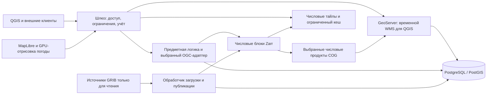

# Прототип метеорологического приложения Гидрометцентра — спецификация

Версия: 0.8 · 29.10.2026 · **Согласована для передачи в разработку.**

19.10.2026 пользователь согласовал редакцию 0.2, этапы M1–M5 и критерии A1–A12, затем поручил обновить спецификацию и задачи для числовых тайлов и отрисовки на GPU браузера. Редакция 0.3 сохраняет эти идентификаторы и расширяет соответствующие обязательства. Согласование границ работ не означает прохождения новых проверок.

Редакция 0.3 задаёт числовые тайлы и GPU-отрисовку как основной путь отображения погоды в браузере. Временной WMS GeoServer остаётся обязательным для QGIS. Ядро Zarr, контракты point/EDR, правила взаимодействия и отложенный Martin сохраняются. [Задача #15](https://github.com/stepanosokin/hmc-app-prototype/issues/15) выбрала узкий числовой HTTP-адаптер для измеренных точечных запросов и метаданных; кодирование тайлов, тайловый движок и производительность GPU требуют отдельных свидетельств. См. [ADR 0002](../../docs/adr/0002-numeric-browser-tiles.md).

[Английская версия](spec.md) · [Карта решений](map.md) · [Словарь предметной области](../../GLOSSARY.md)

Редакция 0.4 добавляет согласованную пользователем возможность подключения TLS в разделе 10.1 и T21 / №33. Идентификаторы M1–M5/A1–A12 сохраняются; реализация TLS и эксплуатационное включение пока не проверены.

Редакция 0.5 закрепляет подтверждённую пользователем концепцию дизайна по ориентиру Windy в разделе 9.1 и [T22 / №34](https://github.com/stepanosokin/hmc-app-prototype/issues/34). Все решения Q1–Q8 и общее понимание явно подтверждены 20.10.2026. Состав функций и M1–M5/A1–A12 сохраняются; базовый макет теперь согласован визуально и #34 закрыта, проверка рабочей карты ещё предстоит.

Редакция 0.6 закрепляет согласованный выбор только отображения веб-карты в разделе 9.2: Mercator, строгий ортографический глобус и фиксированную EPSG:3576. T23 / №35 проверяет техническую реализуемость до расширения принятого макета в T24 / №36 и рабочей карты в #25/#27. Идентификаторы M1–M5/A1–A12 сохраняются; новые критерии реализации ещё не проверены.

Редакция 0.7 закрепляет подтверждённые пользователем стабильную навигацию по времени и реальный прогнозный ряд точки в разделе 9.3. Q1–Q9 и общее понимание подтверждены 21.10.2026. Сохранение карты, моментальная смена готового грида и график точки — новые непроверенные обязательства; M1–M5/A1–A12 и исторические состояния выполнения сохраняются.

## 1. Назначение и границы

Дополнение T23a / [№37](https://github.com/stepanosokin/hmc-app-prototype/issues/37),
явно утверждённое 20.10.2026: реализовать версионированный кандидат
[`hmc-native-display/1`](../../publication/native-display.v1.json) рядом с
замороженным `hmc-temperature-tile/2`. Доставлять нативные ячейки float32,
маски валидности и halo в одну ячейку для однократной билинейной интерполяции
на GPU; сравнить с ограниченными серверными производными отображения по
независимому raw-GRIB в тех же географических точках.
[Утверждённый проект](../../docs/design/t23a-native-display-draft.md) задаёт URL,
matrix/CRS, преобразование при нулевой высоте, immutable cache identity и лимиты
ресурсов. Point/EDR сохраняют канонический nearest-native-cell. Технический
эксперимент не устанавливает приёмку вращения глобуса или физических Android/iOS;
эти обязательства сохраняются в T23 и проверках рабочей карты. M1–M5/A1–A12 сохранены.

Разработать самостоятельно размещаемый прототип метеорологического приложения, который демонстрирует загрузку предоставленного файла GRIB2, нормализацию числовых данных, публикацию на веб-карте и внешний доступ из QGIS с аутентификацией. Интерфейс приложения — русский, временные отметки — UTC. Этот документ — действующий контракт реализации; завершённое планирование и локальные числовые проверки не подтверждают готовность развёрнутой системы.

Первый выпуск включает доступное в образце поле температуры и сроки прогноза, числовые тайлы для отображения и адаптивную карту с GPU-отрисовкой, легендой, управлением временем и просмотром значений, документированные API, ключи организаций, ограничения и учёт обращений, поэтапную публикацию, хранение и эксплуатационную диагностику. Он формирует интерфейсы для последующего подключения снимков, наблюдений, гидрологии и долгосрочных прогнозов.

Нативное мобильное приложение, промышленное подключение десятков источников, рабочие соединения с внешними БД, анимация частиц ветра, выгрузка числовых растров, платежи, тарифы и слои Martin/векторных тайлов отложены. Числовые тайлы для отображения входят в объём работ; отложенная выгрузка числовых растров означает массовый экспорт покрытий для анализа. Будущие модули не обязаны использовать форматы хранения метеорологического модуля.

## 2. Исходные сведения и расчётные условия

| Позиция | Требование или имеющиеся сведения |
| --- | --- |
| Входные данные | `data/grib/ICON_EU_T_G_2026101500.grib2`, 26 658 586 байт |
| Предварительная опись | 24 сообщения; исходный срок расчёта 15.10.2026 00:00 UTC; заблаговременность +1…+24 часа с шагом час; регулярная географическая сетка 1377 × 657 |
| Идентификация поля | Коды параметра 0/0/0, тип поверхности 1. Подтвердить температуру поверхности; не обозначать как температуру воздуха на высоте 2 м. |
| Проверка декодера | Для шаблона упаковки 5.42 необходимо успешно декодировать CCSDS выбранной сборкой ecCodes с поддержкой AEC. |
| Общая нагрузка | Десятки моделей; отдельные файлы до нескольких ГБ; часть источников обновляется каждые 15 минут, часть — ежечасно |
| Аудитория | Менее 100 одновременных пользователей — оценка для планирования, а не подтверждённая производительность. |
| Глубина хранения | Первоначально семь суток по исходному сроку расчёта модели; настраиваемое увеличение до 30 суток |
| Размещение | Один Linux-сервер под управлением организации, Docker Compose, собственная инфраструктура во время работы; интернет доступен при установке |

Имеются локальные свидетельства [T1 — декодер](../../docs/decoder.md), [T2 — хранение](../../docs/storage.md) и [T3 — адаптер](../../docs/validation/archives.md) для образца. T2 проверяет точность Zarr/COG; его свидетельства A2 не охватывают новые проверки кодирования/ресэмплинга тайлов. T3 измеряет точечные запросы и метаданные на согласованной рабочей станции; замеров числовых тайлов и GPU пока нет. Реальная публикация, QGIS и общесистемные проверки остаются обязательствами реализации. Частота обновления сама по себе не определяет число отдельных расчётов модели. Подбор сервера явно отложен. См. [опись образца](assets/sample-inventory.md).

## 3. Архитектура и ответственность

| Ответственность в Compose | Предлагаемая реализация |
| --- | --- |
| Внешний шлюз | TLS/reverse proxy, публичные и защищённые маршруты, идентификация запросов, аутентификация, ограничения и учёт до выдачи ответа из защищённого кеша |
| Веб-интерфейс | Русскоязычное приложение TypeScript/MapLibre; декодирование числовых тайлов, GPU-текстуры и отрисовка скалярного поля; локальные ресурсы времени выполнения |
| API | Предметные каталог, доступность, выборка и доступ организаций; выбранный узкий числовой адаптер; версионируемые метаданные и выдача числовых тайлов |
| Обработчик | Опись источников, декодирование, нормализация, производные продукты, проверка, публикация, повторы и очистка; задания сохраняются в PostgreSQL |
| Геосервис | Временной WMS GeoServer/ImageMosaic для QGIS и других клиентов изображений; ограниченный кеш изображений |
| База данных | Метаданные, манифесты, задания, записи потребителей/ключей и обращений в PostgreSQL/PostGIS; отдельные схемы и роли приложения и мозаичного индекса |

API и обработчик используют общую предметную логику и идентификаторы продуктов; допускается один образ с разными командами запуска. Отдельный сервис для каждой предметной области не требуется. Начальная конфигурация не требует Kubernetes, публичного облачного хранилища, распределённой очереди или отдельного обязательного контейнера Martin. Точные версии образов и библиотек фиксируются на этапе проверки совместимости.

Числовые тайлы могут формироваться в существующем образе API/обработчика с общим разрешением выборки; отдельный сервис необязателен. В #16 сравниваются использование GeoServer для числовых тайлов, готовый числовой тайловый инструмент и небольшая собственная реализация. Выбор требует доказанной поддержки кодирования, масок, проекции, редакций и приемлемых затрат браузера; GeoServer предпочтителен там, где выполняет контракт без потери чисел в цветном изображении. GPU-слой браузера применяет палитру к декодированным значениям. Цветные WMS/тайлы сохраняются для ГИС и сравнительного измерения; резервный браузерный путь требует явного поддерживаемого контракта.

### 3.1. Альтернативы OGC API и порядок выбора

Свидетельств, что pygeoapi наиболее эффективен для этой нагрузки, нет. Готовая поддержка Zarr/EDR делает его подходящим кандидатом для интеграции; эффективность включает задержки, полезную пропускную способность, CPU/RAM/I/O, обновление публикаций и трудоёмкость сопровождения. Замеры сервисов векторных объектов не ранжируют числовые адаптеры массивов.

| Кандидат | Существенные возможности | Применимость и ограничения |
| --- | --- | --- |
| pygeoapi | Готовые провайдеры Xarray EDR Position/Cube для Zarr/NetCDF; широкий набор стандартных адаптеров | Кандидат для числовой выдачи; интеграция расчёта/редакции требует доработки, готовая поддержка Instances отсутствует. Преимущество по производительности не установлено. |
| ldproxy | Features/CRS/фильтрация/Tiles и отображение схем PostGIS | Кандидат для будущего сервиса объектов; прямое обслуживание Zarr/EDR в документированной описи провайдеров не установлено. |
| OGC API GeoServer | Использование уже предусмотренного ГИС-сервера и каталога объектов | Расширение Features имеет документированную проверку Core/CRS. Отдельные модули Maps/Tiles/Coverages отличаются зрелостью и ограничениями; их нельзя приравнивать к зрелому WMS. Прямой путь Zarr EDR не установлен. |
| TiPG | Специализированные Features/Tiles по PostGIS и SQL-функциям | Кандидат для будущих векторных данных; документирован пробел Features CRS Part 2, прямого пути Zarr EDR нет. |
| pg_featureserv | Специализированный сервис объектов по таблицам/функциям SQL | Кандидат для узкого API PostGIS; не сервис числовых массивов или временных растров. |
| Узкий адаптер Xarray/HTTP | Прямое использование той же предметной функции выборки и точное управление прогнозной семантикой | Числовой вариант для сравнения; проект отвечает за OGC-ресурсы, схемы, кодировки, ошибки и проверку соответствия. |

См. [сравнение по первичным источникам](../../docs/research/ogc-api-alternatives.md), [матрицу pygeoapi EDR](https://docs.pygeoapi.io/en/stable/publishing/ogcapi-edr.html), [спецификации ldproxy](https://docs.ldproxy.net/references/specifications), [статус GeoServer Features](https://docs.geoserver.org/stable/en/user/services/features/status/) и [матрицу TiPG](https://developmentseed.org/tipg/). В M1 фиксируются выпущенная реализация и соответствующая документация; изменяющиеся страницы и бета-модули не доказывают готовность развёртывания.

Согласованная проверка M1: сравнить pygeoapi с узким адаптером, вызывающим **одну и ту же** функцию выборки Zarr по манифесту. До сравнения скорости требуется равенство значений/масок, точных времени/расчёта/редакции, обработки отсутствия данных, смысла ответа и политики шлюза. Фиксируются хост/ресурсные ограничения контейнеров, зависимости, контрольные суммы данных, чанки, состав запросов и число обработчиков; холодный и прогретый кеш измеряются отдельно, замеры повторяются. Проверяются необходимые сейчас точечные запросы и метаданные; временные ряды/кубы используются только как явно обозначенные эксперименты будущей нагрузки. Отчёт содержит p50/p95/p99, полезную пропускную способность, ошибки, CPU/RSS/I/O, байты, свежесть публикации и объём интеграционных доработок. Допустимые задержки/ресурсы для измерительного хоста согласуются до выбора победителя; образец не обосновывает промышленный SLA.

Один числовой адаптер выбирается до фиксации реализации M3; все кандидаты вместе не поставляются. Для временного WMS используется GeoServer. Сервисы объектов сравниваются после появления репрезентативных векторных схем/данных. Это сохраняет единый внешний контракт и допускает разные движки для разных операций.

Результат M1: [ADR 0001](../../docs/adr/0001-numerical-http-adapter.md) и [свидетельства T3](../../docs/validation/archives.md) выбирают узкий адаптер для ограниченных точечных запросов и метаданных. Выше сохранена методика выбора. Она не ранжирует тайловые движки и не доказывает общее соответствие OGC; pygeoapi можно независимо пересмотреть для последующего профиля стандартов.

## 4. Идентификация данных и загрузка

Поле идентифицируется поставщиком/моделью, исходным сроком расчёта, идентификаторами параметра и таблиц, поверхностью/уровнем или границами слоя, сеткой, участником ансамбля при наличии, временем действия или интервалом и редакцией источника. Для будущих накопленных/осреднённых величин сохраняется смысл статистической обработки. Файл, расчёт модели и время действия — разные понятия.

Первоначально адаптеры источников работают с локальными путями или каталогами, подключёнными только для чтения; протокол файлового сервера и реквизиты доступа настраиваются после их предоставления. Завершение записи определяется манифестом производителя или сигналом атомарной доставки, если они доступны. Иначе применяется документированная выдержка стабильности размера/времени изменения с проверкой структуры и повторами; одна стабильность файла не доказывает полноту поставки производителя. Незавершённые, повреждённые и неподдерживаемые файлы помещаются в карантин.

Контрольная сумма источника и версия конвейера обеспечивают идемпотентность. Исходные байты сохраняются в управляемом хранилище, если повторное получение с исходного сервера не гарантировано. Фиксируются происхождение данных и версии декодера/таблиц определений. Обработка идёт ограниченными совместимыми порциями; возможность целиком загрузить многогигабайтный файл в память без ограничений не предполагается.

## 5. Гибридное хранение и выбранные картографические продукты

Zarr — нормализованное числовое ядро. Проверка совместимости начинается с явно заданного формата Zarr 2 и кодирования без потерь; фиксируется проверенная цепочка записи, чтения и кодеков вместо зависимости от настроек пакетов по умолчанию. Сохраняются координаты, единицы, маски и метаданные GRIB. Провайдер разрешает опубликованный манифест в требуемое представление поля и срока.

Доступные группы полей/сроков записываются неизменяемыми порциями с разделением по совместимым сеткам и вертикальной структуре. Небольшой неизменяемый манифест расчёта повторно использует неизменившиеся порции; запоздавшие/исправленные данные создают новые порции и редакцию публикации. Весь растущий расчёт не копируется при каждом обновлении. Укрупнение хранения завершённых расчётов — последующая оптимизация по результатам замеров; старые ссылки сохраняются до безопасного удаления.

Профили публикации задают нормализуемые поля/уровни и подмножество для карты. Для образца загружаются все 24 сообщения и публикуются все успешно проверенные сроки его единственного поля. Числовые COG создаются **из этих порций Zarr**, с кодированием без потерь, масками и пирамидами разрешений. Сохраняется числовая идентичность исходной сетки; GeoServer перепроецирует WMS, а числовые тайлы явно задают собственные проекцию/ресэмплинг. Обзорные уровни и интерполированные GPU-значения не служат источником канонических точечных значений.

Прототип должен подтвердить числовое соответствие эталону ecCodes после записи и чтения. В ядре Zarr сохраняются конечные значения и маски. Преобразование типа данных COG требует зафиксированного допуска для конкретной величины; для температуры образца первоначальный технический критерий — абсолютная ошибка преобразования не более 0,0001 K. Превышение блокирует публикацию. Отдельно проверяются центры ячеек, порядок сканирования, нормализация долгот и привязка с учётом половины шага сетки.

Гибрид добавляет затраты CPU/диска на производные продукты и согласование публикации. Преимущество по объёму или скорости не установлено. Последующий выбор чанков и пирамид требует измерений.

### 5.1. Контракт числовых тайлов для отображения

Тайлы создаются из выбранных по манифесту значений Zarr напрямую либо через проверенный числовой производный продукт. До фиксации движка сравниваются массивы чисел с плавающей точкой и упакованные значения с фактическими замерами декодирования/загрузки в GPU. Фиксируются версионируемые метаданные, шаблон URL/content type, матрица тайлов/CRS, диапазон масштабов, размеры/начало/ориентация, каналы, dtype/порядок байтов либо масштаб/смещение, единицы, сжатие, маска nodata и правила ресэмплинга/краевых ячеек. Обычные цветные изображения не заменяют числовые значения. Эта спецификация не выбирает кодирование или форму URL.

До выбора кодирования согласуются допуски отображения для конкретной величины: декодированные значения сравниваются с каноническим эталоном после заявленного ресэмплинга, включая квантование и GPU-интерполяцию. Существующий допуск преобразования COG 0,0001 K сохраняется отдельно. Проверяются переход от исходной сферы/географических координат к карте, положение ячеек, границы покрытия, стыки/краевые ячейки тайлов и маски отсутствия данных. Смысл интерполяции отображения документируется; point и EDR сохраняют точное время и ближайшую исходную ячейку. CoverageJSON кодирует ответ position, а не браузерные тайлы.

## 6. Публикация и поведение при сбоях

Жизненный цикл: `discovered → staged → decoded → normalized → derivatives_ready → validated → published`; неудачные этапы сохраняют диагностику и допускают повтор. Прогресс учитывается по полю/сроку. Полнота расчёта отделена от пригодности: одного проверенного срока, готового для карты, достаточно для использования частичного расчёта. Без ожидаемой описи производителя полнота считается неизвестной.

Общая редакция публикации становится видимой только после надёжной записи, проверки и готовности к запросам соответствующих Zarr, COG, пути/метаданных числовых тайлов и выборки геосервиса. Для предварительного либо ленивого формирования явно определяется готовность тайлов и до открытия публикации выполняются детерминированные репрезентативные запросы; создавать заранее все возможные тайлы не требуется. Внутренние маршруты подготовки и администрирования GeoServer закрыты извне. Публичные запросы capabilities, карты, identify, тайлов и числовых данных ограничены выбранным манифестом. Транзакция PostgreSQL сама по себе не синхронизирует независимые изменения индекса GeoServer: на этапе интеграции нужно подтвердить механизм допуска к публикации и выбор гранул по редакции, включая метаданные обнаружения.

Новые проверенные сроки публикуются по мере готовности. Читатели фиксируют расчёт и редакцию; исправления не перезаписывают продукты, на которые ссылается опубликованная редакция. Ключи числового кеша включают расчёт/редакцию, поле, уровень, точное время, сетку/участника ансамбля, матрицу/координаты тайла, ресэмплинг и версию кодирования. Палитра меняется локально без повторной загрузки неизменившихся числовых тайлов. Версии стиля/шейдера входят в идентичность отрисованных продуктов, не обесценивая исходные числовые байты. Появление нового расчёта или редакции не меняет выбор пользователя автоматически.

Сбой производного продукта или индексации сохраняет предыдущую пригодную редакцию. Возобновление после перезапуска обработчика идемпотентно; брошенные промежуточные данные допускают сборку мусора. Ограничиваются задания, параллелизм, повторы и бюджеты диска/кеша.

## 7. Контракт API и ГИС

Приведённый ниже контракт не зависит от OGC-сервера, выбранного через M1. Предметная логика разрешает явно заданные расчёт/редакцию/время до чтения нормализованных данных. При выборе pygeoapi стандартный Zarr-провайдер EDR по-прежнему требует интеграционных доработок провайдера/маршрутизации; при выборе узкого адаптера проект явно реализует объявленный профиль OGC. В начальном профиле EDR `run` и `revision` — документированные расширения параметров запроса; поддержка стандартных Instances не заявляется без реализации.

| Интерфейс | Начальный контракт |
| --- | --- |
| `/ogc/collections` и метаданные коллекций | Обнаружение разрешённых продуктов и ссылок на запросы/картографическую выдачу |
| `/ogc/collections/{collectionId}/position` | EDR position с `coords`, `datetime`, `parameter-name` и явными `run`/`revision`; ответ CoverageJSON |
| `/api/v1/modules`, `/api/v1/models`, списки моделей/расчётов/редакций | Предметный каталог и доступность; фактические идентификаторы и доступные измерения |
| `/api/v1/point` | Документированный числовой запрос с layer/run/revision/valid_time/lon/lat; общий с EDR механизм разрешения выборки |
| `/gis/v1/runs/{runId}/revisions/{revision}/wms` | Ограниченное выбранными расчётом/редакцией WMS 1.3.0-соединение через шлюз; capabilities, карта, легенда, identify |
| Ссылки и метаданные числовых тайлов из каталога | Фиксированная опубликованная выборка; версионируемые кодирование/матрица/маска/ресэмплинг и кешируемые числовые значения для GPU |

Координаты предметного point API — именованные долгота/широта в градусах. EDR следует объявленным CRS/профилю. WMS соблюдает порядок осей своей версии и CRS; единый порядок не переносится между интерфейсами без проверки. Точечный ответ содержит идентичность выборки, координату выбранной исходной ячейки, единицы, метод выборки, значение или явную причину отсутствия и происхождение данных. Пространственный метод по умолчанию — ближайшая исходная ячейка; выбор времени — точный.

Предметный API различает ошибочный ввод (400), права доступа (401/403), недоступную выборку (404), истёкший срок хранения (410), ограничения (429) и временный сбой обработки/сервиса (503). Для корректной точки вне покрытия или с nodata возвращаются явное пустое значение и причина, без подстановки крайней ячейки. OGC-интерфейсы используют свои документированные профили ответов/исключений. Отсутствующий срок не заменяется ближайшим временем или другим расчётом. Публикуются OpenAPI и исполняемые примеры; при интеграции фиксируется поддерживаемая версия QGIS.

QGIS должен подключаться с ключом организации в заголовке, выбирать доступные сроки, отображать то же поле и получать значения, согласованные с числовым эталоном. URL WMS явно задаёт расчёт/редакцию; объявленные ссылки и временной диапазон сохраняют это ограничение. Проверяются EPSG:4326 и EPSG:3857, маски, легенды и identify исходного разрешения. Установка продукта сама по себе не подтверждает соответствие OGC.

Числовые тайлы используют документированный версионируемый HTTP-контракт и сами по себе не подтверждают OGC API Tiles. Фасады OGC API Tiles/Maps можно включить после проверки передачи измерений и применимого профиля. Выгрузки покрытий и более широкие EDR-запросы отложены. Martin предусмотрен для будущих векторных объектов; научные поля U/V и плотные скалярные массивы автоматически не становятся продуктами MVT.

## 8. Доступ, учёт и будущий биллинг

Демонстрационная карта публична и не содержит секрета организации. Внешний API/ГИС-доступ организаций использует независимо отзываемые ключи, ограничения на уровне организации и журнал обращений. Ключи и квоты проверяются до выдачи ответа из защищённого кеша; прямые обращения к внутренним сервисам или продуктам не должны обходить этот контракт. Публичная демонстрация имеет отдельные ресурсные ограничения.

Предусмотреть операторские команды создания, отзыва и ротации ключей и настройки лимитов; административный портал на этом этапе не нужен. Ограничиваются размеры изображений, масштабы/байты числовых тайлов, их формирование, параллелизм, длительность, рост кеша, объём ответа и частота обращений. Хранить защищённые представления ключей; открытые секреты не записывать в журнал. Учитывать идентификатор запроса, организации/ключа, операцию, продукт/расчёт/редакцию, время UTC, статус, длительность, байты и результат кеширования при наличии. Включать попадания в кеш и отклонённые обращения; документировать повторы и правила учёта. Платежи, денежные расчёты и тарифная политика не реализуются. Публичные данные остаются доступными для просмотра независимо от будущей политики оплаты API.

## 9. Веб-интерфейс

Русские подписи, время UTC, карта на весь экран, компактный выбор модели/поля/расчёта, нижняя шкала времени, стабильная легенда продукта и карточка точки. На малых экранах — сворачиваемая панель с сохранением контекста расчёта/времени. Показываются только реализованные модули и продукты. Указываются источник, возраст данных, исходный срок расчёта, время действия, доступность и полнота/неизвестный статус.

По умолчанию выбираются новейший пригодный расчёт и его первый доступный срок. При выборе другого расчёта используется его первый доступный срок. При перемещении по времени расчёт и редакция фиксированы; недоступные сроки отмечены, их выбор очищает слой и значение. Новые данные вызывают уведомление; смена расчёта или обновление доступности выполняются явно. При изменении времени/расчёта прежний результат точки очищается; запоздавшие ответы для прежней выборки отбрасываются.

Различаются загрузка, отсутствующий срок, точка вне покрытия, nodata исходного поля и ошибка сервиса. При сбое обновления сохраняются последние опубликованные данные. Начальные стили относятся к фактическому полю температуры поверхности; анимация ветра и вымышленные слои наблюдений не показываются. Подложка, стили и шрифты обслуживаются локально с указанием источников и проверенными правами распространения; для первого выпуска достаточно простой региональной подложки.

Скалярная температура отображается GPU-слоем MapLibre из числовых текстур. Единицы, цветовая шкала и легенда согласованы; маски не допускают просачивания цвета у nodata и стыков тайлов. Ограничиваются предзагрузка/кеш тайлов, декодированные массивы и GPU-текстуры; устаревшие запросы отменяются, результаты прежней выборки отбрасываются до загрузки в GPU, ресурсы освобождаются, потеря контекста восстанавливается. Требуемые возможности GPU проверяются; предусматривается документированный поддерживаемый резервный путь либо понятное сообщение о недоступности отрисовки. Незаметно пустая карта недопустима. Смена палитры не загружает неизменившиеся числа повторно. Смешивание через пропуски сроков, расчёты или редакции запрещено; временное смешивание и частицы ветра отложены. Образец не содержит U/V.

### 9.1. Визуальная концепция по ориентиру Windy — v0.5

[Windy.com](https://www.windy.com/) — согласованный ориентир компоновки и плотности интерфейса. Используются собственные цвета и оформление Гидрометцентра, компактные кнопки и полупрозрачные панели, русские элементы управления/состояния/сообщения и время UTC. Ориентир не расширяет состав функций: первый выпуск показывает фактически доступное поле температуры; частицы ветра, временное смешивание и другие отложенные продукты сохраняют свой статус. [Подтверждённая концепция](../../docs/prototypes/design-concept.ru.md) фиксирует Q1–Q8; прежний условный HTML остаётся макетом взаимодействия, а не согласованным визуальным дизайном.

- Карта занимает весь экран, компактные элементы управления размещаются поверх неё. На компьютере модель/поле/расчёт находятся слева сверху, выбор слоёв — справа, временная шкала — снизу, стабильная легенда — справа над ней. Значение выбранной точки показывается рядом с маркером.
- При первом открытии показывается всё покрытие доступного прогноза. Кнопка «К области данных» возвращает к этому охвату. Сохраняется выбор самого нового пригодного расчёта и его первого доступного срока; пространственный охват не меняет фиксированную выборку и поведение пропущенных сроков.
- Время расчёта и время прогноза UTC постоянно видны. Подробности источника/публикации раскрываются отдельно; требования к указанию источников, возрасту, доступности и полноте данных сохраняются.
- На телефоне используется единая нижняя панель, изначально свёрнутая. Нажатие на карту раскрывает сведения о точке до половины экрана; настройки используют ту же панель. Временная шкала и выбранное время остаются доступны, контекст расчёта/времени сохраняется.
- Панели тёмные полупрозрачные, текст светлый; подложка спокойная, температурная шкала выразительная и согласована с легендой. Точные оттенки, размеры, прозрачность и читаемость оцениваются на визуальном макете.
- [T22 / №34](https://github.com/stepanosokin/hmc-app-prototype/issues/34) создаёт интерактивный HTML-макет для компьютера и телефона с русскими подписями и явно обозначенными демонстрационными данными до подключения реальных данных. Фиксируются проверки видимых взаимодействий, изображения обоих видов и визуальное согласование пользователем. Базовый макет T22 согласован, #34 закрыта 20.10.2026; исторические свидетельства сохранены. T24 / №36 расширяет его после T23 / №35.

Согласованный макет направляет реализацию рабочей карты №25 и адаптивного интерфейса №27; их проверки реального образца, числовых значений/GPU и Compose сохраняются. Демонстрационный макет не подтверждает A2/A3/A8/A11 и не заменяет реальные свидетельства браузера/ГИС. Подложка, стили и шрифты сохраняют требования локального обслуживания, указания источников и прав распространения; ориентир дизайна не подразумевает использование ресурсов или сервисов Windy.

### 9.2. Проекции отображения веб-карты — v0.6

Пользователь подтвердил Q1–Q9 и общее понимание 20.10.2026. См. [ADR 0003](../../docs/adr/0003-web-map-display-projections.md). Выбор меняет только отображение веб-карты: исходное/нативное хранение и каноническая семантика point/EDR сохраняются; внешний WMS/QGIS по-прежнему требует EPSG:4326/3857 без обязательного расширения CRS.

- Предоставить русское управление «Меркатор» (EPSG:3857), «Глобус» — строго ортографический, вращаемый, с приближением, и «LAEA — Арктика (EPSG:3576)». Для LAEA закрепить WGS 84 / North Pole LAEA Russia: широта начала 90° с. ш., долгота начала 90° в. д., нулевые ложные смещения, WGS84, метры; пользователь не меняет центр LAEA в этой версии.
- Ограничить показ LAEA широтами от 45° с. ш., явно объяснить ограничение; южная часть прогноза доступна в других режимах. Это ограничение области отображения, а не native nodata или потеря исходного покрытия.
- При каждом открытии страницы использовать Mercator и охват всего доступного прогноза; последний режим не запоминается. «К области данных» возвращает к покрытию, видимому в текущем режиме, без изменения выборки прогноза.
- Переключение сохраняет расчёт/редакцию/срок/единицы и выбранную географическую точку. Центр и сопоставимый географический охват сохраняются по возможности; числовой zoom между проекциями может различаться. Маркер за горизонтом глобуса или вне области LAEA скрывается, выбор сохраняется с русским объяснением. Прежние правила очистки при смене расчёта/срока действуют.
- Согласовать значения/маски погоды, локальную подложку, подписи, геометрию покрытия, маркер и обратный пересчёт экранного нажатия во всех режимах. Каноническое значение берётся из point API после перевода координат, никогда из цвета. Нажатия на фон вне глобуса или вне области отображения режима не выбирают географическую точку.
- Определять недоступность режима, показывать русское объяснение и предлагать явный переход в Mercator. Тихая подмена перспективным глобусом и автоматическая смена режима запрещены; требования обработки потери контекста GPU, ресурсов и ошибок сохраняются.
- При необходимости разрешены производные серверные тайлы отображения, включая EPSG:3576. Выбор между браузерным перепроецированием и серверными производными основан на свидетельствах. Замороженный контракт v2 и исторические доказательства сохраняются; новый контракт явно различает версию/matrix/CRS и параметры сетки в metadata, URL и ключах кеша, сохраняет selection/доступность/доступ/бюджеты/retention, проверяет readiness и применимые регрессионные gates до рабочего использования. Решение не требует отдельного сервиса.
- Сначала завершить [T23 / №35](https://github.com/stepanosokin/hmc-app-prototype/issues/35): реальные числовые тайлы через gateway/Compose, строгую ортографию, EPSG:3576, локальную подложку, независимые проверки значений/положения/масок/стыков, обратный выбор точки и затраты desktop/mobile. Сохранить суммарный допуск отображения ≤0,01 K и кодирования ≤0,001 K с учётом дополнительной интерполяции, отдельно от предела COG ≤0,0001 K и существующей гипотезы datum. Добавить явно обозначенные синтетические случаи полюса/перехода ±180°/горизонта там, где европейского образца недостаточно. Доказанная несовместимость требует пересмотра решения, а не тихой замены MapLibre или ортографии.
- Затем завершить [T24 / №36](https://github.com/stepanosokin/hmc-app-prototype/issues/36), отдельно архивируемое расширение принятого макета T22 с новым визуальным согласованием; затем реализовать #25/#27. Если T23 докажет необходимость серверных изменений, создать связанную задачу реализации и завершить её до приёмки рабочей карты. #28 проверяет локальные ресурсы во всех режимах, #31 измеряет каждый режим и переключения, #32 индексирует итоговые свидетельства. #16/#22/#23/#24/#34 остаются закрытыми, если независимо не обнаружен дефект их принятого объёма.

Идентификаторы M1–M5 и A1–A12 сохраняются. Дополнение распространяет числовые проверки и выбор точки A2/A3, переключения/гонки/ресурсы/интерфейс A5/A8, локальные ресурсы A11 и измерения A12 на все режимы; A6/A7/A9 применяются к новым серверным производным. Согласование, техническая проверка и макет сами по себе не завершают приёмку рабочей карты.

### 9.3. Стабильная навигация по времени и прогнозный ряд точки — v0.7

Пользователь подтвердил Q1–Q9 и общее понимание 21.10.2026; см.
[запись решений](time-navigation-graph-discussion.md). Это новые, ещё не проверенные
требования к реализации. M1–M5/A1–A12 и исторические выполненные задачи/свидетельства
сохраняются; дополнение расширяет A3/A5/A8/A12 и не означает их выполнения.

**Стабильная карта.** Смена срока ползунком, элементами времени или графиком
обновляет только тематическое покрытие и связанные время/значение/состояние
загрузки (при необходимости — легенду). Сохраняются существующий Map, подложка,
подписи, проекция, географическое положение/масштаб камеры, выбранная точка и
состояние панели. Карта не пересоздаётся, неизменившаяся подложка не загружается
повторно из-за смены срока, охват не сбрасывается к покрытию. Координаты точки
сохраняются; прежнее числовое значение очищается.

**Моментальная смена грида.** При выборе срока меняется тематический грид без
пересоздания карты. Предыдущий полный кадр сохраняется до готовности нового,
затем заменяется сразу и атомарно, без анимации, интерполяции, перехода
прозрачности, пустой вспышки или частичного кадра. Фактическое время показанного
кадра отделено от запрошенного срока и его загрузки. Последний выбор имеет
приоритет; устаревшие ответы, массивы и загрузки в GPU отбрасываются.
Расчёт/редакция закреплены; маски, допуски и каноническая выборка сохраняются.
Показ промежуточных сроков во время движения ползунка не обязателен.
Моментальная замена относится к готовому кадру и не обещает нулевое время
сетевой загрузки, декодирования и передачи в GPU.

**Пропуски и ошибки сроков.** Выбор отсутствующего срока немедленно убирает
тематический кадр и число точки, сохраняя карту, координаты точки и явное русское
объяснение. При ошибке загрузки доступного срока предыдущий полный кадр можно
оставить только с его фактическим временем и видимой ошибкой; запрошенный выбор
не считается показанным. Вне покрытия, native nodata, отсутствующий срок и ошибка
запроса различаются. Истечение публикации требует явного перевыбора; кеш не может
восстановить истёкший кадр или незаметно сменить расчёт/редакцию.

**Реальный график в карточке точки.** Показывается весь опубликованный прогноз
выбранной точки и поля одного закреплённого расчёта/редакции: канонические значения
nearest-native-cell для точных сроков, UTC и текущие единицы. Выбранный срок
выделяется; если на карте удержан прежний кадр, его отличающееся фактическое время
явно обозначается. Значения не извлекаются из цвета карты, временной интерполяции
или синтетического макета. Исторические наблюдения не входят в состав. Отсутствие
значения и ошибка запроса образуют разрывы линии с разными состояниями; при
частичном сбое успешные части сохраняются, неудавшиеся запросы можно повторить.
Ряд прежней точки/расчёта/редакции нельзя выдавать за новый. Смена только текущего
срока переиспользует неизменившийся ряд и перемещает выделение; новая точка, поле,
расчёт или явно принятая редакция обновляют ряд. Сохраняются правила доступности,
истечения, доступа и ограниченных запросов/кеша; конкретный endpoint и расширенное
соответствие EDR этим требованием не выбираются.

**Взаимодействие с графиком и телефон.** Подсказка UTC/значения доступна мышью,
касанием и клавиатурой. Явный выбор срока на графике выбирает тот же срок на
ползунке и карте, включая правила отсутствующего срока; наведение время не меняет.
На телефоне график размещён во вкладке «Точка» общей панели, помещается по её
ширине и не перекрывает шкалу времени. Контекст точки/панели при смене срока
сохраняется.

**Проверка и ограниченные ресурсы.** Совокупный бюджет управляемых массивов
поля, кешированных кадров, текстур и framebuffer — 128 МиБ. Проверяются Chrome
и Edge desktop и физический Chrome/Android в Mercator, строгой ортографии и
EPSG:3576. Эмуляция не заменяет физическое устройство; Safari/iOS не проверен.
22.10.2026 пользователь отменил T26 / #40: отклик ползунка 100 мс,
p95 подготовленного кадра 100 мс и холодная загрузка 3 с больше не являются
критериями приёмки. Общие измерения нагрузки остаются в #31.

Новые требования остаются неотмеченными до реализации и фактической проверки:

- [ ] Смена срока сохраняет карту/подложку/камеру/точку и обновляет только тематические данные.
- [ ] Готовый кадр грида заменяет предыдущий сразу, без пустых вспышек, анимации и устаревших результатов.
- [ ] Загрузка, пропуск, ошибка, nodata и истечение соблюдают указанные идентичности/состояния.
- [ ] Реальный канонический график охватывает закреплённый ряд, разрывы, частичные ошибки и переиспользование/обновление.
- [ ] Выбор на графике, подсказки, клавиатура/касания и телефон согласованы с картой/ползунком.
- [ ] Воспроизводимые desktop/physical Android свидетельства проверяют три проекции и бюджет памяти.

### 9.4. Изолинии нативных полей и единицы отображения — v0.8

29.10.2026 пользователь поручил реализацию в [№74](https://github.com/stepanosokin/hmc-app-prototype/issues/74).
[Согласованные требования и нормативная таблица 29 полей](../../docs/design/field-contours-discussion.md)
содержат все шаги для мелкого/среднего/крупного масштабов, включая давление
у поверхности 25/20/5 гПа и видимость 20000/10000/5000 м. Классы охвата:
более 6000 км; более 2000 и не более 6000 км; не более 2000 км. Их смысл
сохраняется во всех четырёх проекциях.

Изолинии строятся на лету в фоновом потоке браузера по нативным значениям Zarr
и числовой маске NoData, полученным через сервис с объявленным допуском
кодирования. Растровые пиксели, палитра, прозрачность и выборка на экранную
сетку не являются входами геометрии. Сохраняются допустимые нули, стыки
блоков, идентичность выборки, отмена и общий бюджет 128 МиБ. Кеш ограничен;
зависимости локальные, скорость/память измеряются на реальных полях без нового SLA.

Линии чёрные в тёмной теме, серые #707070 в светлой; разрываются под подписями.
Верх подписи направлен к большим значениям, в том числе для перевёрнутых чисел.
На карте не более семи подписей. Контуры короче 60 экранных пикселей скрываются;
суммарное отклонение после упрощения и сглаживания не более одного пикселя.
Численное поле не сглаживается. Легенда сообщает шаг. Общий переключатель
при открытии включён, скрывает линии и подписи вместе, состояние не сохраняется.
Ручной ввод шага в приложении не запрошен: собственные настройки заданы в чате.

Во всём UI давление отображается в гПа, удельная влажность в г/кг, высота снега
в см, непротиворечивые интенсивности осадков в мм/ч. Исходники, Zarr, численные
API и GIS сохраняют единицы. Четыре диагностических поля используют выбранные
шаги исходных чисел с явной пометкой единиц в легенде; противоречивый
накопленный дождь автоматически не переводится в мм/ч. Расширены A2/A3/A5/A8/A11/A12,
идентификаторы и завершённые состояния сохранены. Закрытие требует реализации
и научной/браузерной приёмки.

## 10. Хранение и эксплуатация

Хранятся расчёты, исходные сроки которых попадают в последние семь суток, включая все их опубликованные сроки прогноза, даже если время действия выходит за это окно. Длительность настраивается до 30 суток без изменения идентификаторов. Правило относится к управляемым приложением оригиналам/копиям, Zarr, COG, числовым тайлам/метаданным, манифестам и серверным кешам; подключённые источники организации никогда не являются целью очистки.

Сначала прекращаются обнаружение и доступ; затем неиспользуемые продукты удаляются после ограниченной отсрочки для выполняющихся запросов. Для заменённых редакций задаются отсрочка и бюджет; сеансы не удерживают файлы бесконечно. Время жизни серверного кеша ограничивается допустимостью данных. HTTP-кеш, декодированные массивы и GPU-кеш браузера удаляют истёкшие или заменённые выборки по документированной политике; повторное использование текстуры не возвращает истёкшую публикацию. Для истёкшей выборки возвращается понятный ответ и предлагается новый выбор. Предусмотреть предварительный просмотр очистки без удаления и отчёт об объёмах. Исторический образец закрепляется в демонстрационном режиме либо используется фиксированное демонстрационное время.

БД и продукты сохраняются в явно заданных томах. Секреты задаются вне коммитируемых данных/конфигурации; читающим сервисам продукты по возможности подключаются только для чтения. Определяются готовность источника, состояние обработчика/API/БД/ГИС, структурированные журналы, очередь заданий, задержка публикации, сбои, диск и кеш. Каталог, конфигурация и метаданные ключей резервируются; описывается восстановление из сохранённых источников. Срок хранения журнала обращений настраивается отдельно. Работа без внешней сети не должна требовать публичных подложек/API. Подбор хоста, публичный DNS и предоставление сертификата/ключа организации остаются входными условиями развёртывания. Реализация настраиваемого TLS — отдельное обязательство раздела 10.1, пока не выполненное.

### 10.1. Опциональный TLS с сертификатами организации — v0.4

Пользователь согласовал дополнение 20.10.2026. [T21 / №33](https://github.com/stepanosokin/hmc-app-prototype/issues/33) добавляет включаемый HTTPS через внешний reverse proxy перед существующим gateway для сайта, числового API, тайлов и GIS. Локальная разработка по HTTP остаётся доступной без сертификатов. После получения серверного сертификата, цепочки доверия и соответствующего закрытого ключа организации оператор включает TLS настройкой развёртывания без изменения кода и пересборки приложения. Настоящие сертификаты организации не являются условием реализации и тестовой проверки этой возможности.

Сертификат/цепочка и ключ передаются внешними PEM-файлами, подключаемыми к TLS proxy только для чтения; они не попадают в Git, образы, web assets, журналы и переносимые доказательства. Закрытые ключи TLS и ключи доступа организаций к API — разные секреты. Документируются имя сервера, внешний HTTPS origin, порты, пути файлов и доверие клиентов к CA. В TLS-режиме защищённые сервисы доступны извне только через HTTPS; открытый HTTP не обслуживает защищённые запросы. Перенаправление не защищает ключ, уже переданный по HTTP. Сохраняются политика gateway, изоляция внутренних сервисов, профиль /org и выбор run/revision. Ссылки каталога, метаданных тайлов и WMS capabilities сохраняют внешний HTTPS origin без mixed content; произвольные клиентские forwarding-заголовки не управляют этим origin и не обходят защиту.

Описываются замена сертификата с проверкой конфигурации и управляемым reload/restart, проверка результата и восстановление предыдущей конфигурации. Отсутствующие, нечитаемые или несогласованные сертификат/ключ вызывают понятную ошибку запуска/конфигурации без автоматического открытия HTTP. Реальный proxy/gateway проверяется тестовой CA и сертификатом для тестового имени с включённой проверкой сертификата: доверенная цепочка/имя, отказ при неверном имени/недоверенной CA, публичные/защищённые API/тайлы/WMS, внешние ссылки, авторизация/отзыв на прогретом кеше, изоляция backend, замена сертификата и ошибки конфигурации. Для затронутых компонентов используются существующие проверки доступа/публикации на реальном образце; доказательства архивируются без закрытых ключей, все тестовые ресурсы удаляются по процессу разработки.

Проверка на тестовых сертификатах доказывает готовность подключения TLS. DNS организации, установка настоящих сертификата/ключа/цепочки и проверка доверия на целевом сервере/клиентах остаются входными условиями эксплуатационного запуска. Автоматический выпуск/продление сертификатов (ACME), взаимный TLS и замена существующей API-аутентификации не входят в T21. Полная приёмка desktop QGIS сохраняется в существующей GIS-задаче.

## 11. Последовательность реализации

| Этап | Результат и условие завершения |
| --- | --- |
| M1 — Декодирование, совместимость и сравнение API | Воспроизводимые инструменты; декодированы все сообщения образца; проверены поле, единицы, сетка, маски и числовое соответствие; зафиксированы средства чтения; обоснованно выбран числовой адаптер по разделу 3.1 |
| M2 — Ядро публикации | Сохраняемые задания, неизменяемые порции/манифесты, готовность/контракт COG и числовых тайлов, идемпотентные повторы и хранение; сбой сохраняет предыдущие данные |
| M3 — ГИС и API | Выборка/допуск GeoServer, WMS QGIS, discovery/position выбранного OGC-адаптера, предметные catalogue/point и числовые тайлы; согласованная выборка и защищённые кеши |
| M4 — Веб-карта | Русскоязычный скалярный GPU-просмотрщик MapLibre, проверенные декодирование/маски/стыки, выборка/UTC/легенда/точка, адаптивное управление и локальные ресурсы |
| M5 — Эксплуатационная передача | Ключи/лимиты/учёт, готовность опционального TLS по T21, перезапуск/очистка/восстановление, документация и совместные измерения сервера/тайлов/GPU браузера по согласованным целям |

Неудачные проверки совместимости не скрываются фиктивными данными или незаявленной заменой архитектуры. Если выбранные продукты не выполняют требования, результаты фиксируются и соответствующее решение пересматривается.

## 12. Приёмка и измерения

| ID | Свидетельства, необходимые при реализации |
| --- | --- |
| A1 | Все 24 сообщения образца декодируются; идентичность, сроки, поверхность, единицы, маски и координатная привязка записаны и проверены. |
| A2 | Сохраняются свидетельства точности/масок Zarr и COG; кодирование/декодирование тайлов, заявленный ресэмплинг и GPU-интерполяция проходят отдельные согласованные допуски отображения в ячейках, на границах покрытия и стыках тайлов. |
| A3 | Тайлы/GPU браузера, point, EDR position и QGIS используют одинаковые расчёт/редакцию/время/поле. Декодированные значения отображения сравниваются с эталоном по заявленным ресэмплингу/допускам; каноническое значение по щелчку берётся из point API, а не из цвета. |
| A4 | Capabilities, время, легенда и identify в QGIS работают с реквизитами доступа в зафиксированной версии клиента и обеих указанных CRS. |
| A5 | Обозначенные наборы проверяют перекрывающиеся расчёты, пропуски, запоздавшие/исправленные порции и старые редакции без смешивания, включая задержки загрузки/декодирования/передачи тайлов в GPU при навигации и явном обновлении. |
| A6 | Сбой/повтор, ошибки формирования/готовности метаданных числовых тайлов и ГИС-продуктов/индексации не раскрывают незавершённые выборки и не заменяют последнюю пригодную публикацию. |
| A7 | Публичные/защищённые числовые, тайловые/метаданные и ГИС-маршруты проверяются на неверные/отозванные ключи, лимиты, прогретый кеш, истечение срока, обход защиты и учёт. |
| A8 | Русский интерфейс/UTC, согласованные компоновка Windy и мобильное поведение раздела 9.1 и визуально согласованный макет T22, GPU-значения/маски/легенда, загрузка/ошибки/nodata, отбрасывание старых точек/тайлов, ограниченный жизненный цикл ресурсов и явная обработка возможностей/потери контекста GPU соответствуют контракту. Один макет не подтверждает работу приложения. |
| A9 | Хранение семь/30 суток безопасно исключает управляемые расчёты и числовые тайлы/метаданные/серверные кеши; браузерный кеш не возвращает истёкшие выборки; источники и правила исторической демонстрации сохранены. |
| A10 | Запуск/перезапуск Compose, постоянное хранение, диагностика и инструкции восстановления работают на согласованном Linux-хосте; включение опционального TLS, замена сертификата и ошибки конфигурации проходят проверки раздела 10.1 на тестовых сертификатах до получения реквизитов организации. |
| A11 | Сетевые проверки и работа без публичного доступа подтверждают локальную выдачу подложки/стилей/шрифтов, шейдеров, декодеров и необходимых WASM/workers; обязательных публичных сервисов нет. |
| A12 | Отчёт фиксирует нагрузку/хосты/браузеры/конфигурацию, сравнение point/metadata M1, загрузку/публикацию/сервер, холодные/прогретые числовые тайлы и эталон изображений, байты, декодирование/загрузку в GPU, время кадра/FPS, память браузера/GPU, кеш/диск/ошибки/очередь. Цели сервера и настольных/мобильных браузеров согласуются до заявления готовности. |

Корректность проверяется на образце; подбор ресурсов — затем на репрезентативных многогигабайтных обновлениях нескольких величин/моделей. Проверяются холодные/прогретые карты и точки одновременно с загрузкой, с настраиваемым параллелизмом, например 1/10/50/100 клиентов. Это профили измерений, а не гарантия выполнения неопределённого SLA при 100 клиентах. Сравниваются объёмы за семь и 30 суток с учётом исходных копий, Zarr, выбранных COG/пирамид, подготовки, старых редакций и кеша. Отсутствие промышленного объёма данных и характеристик сервера пока не позволяет обоснованно гарантировать производительность.

## 13. Расширения и недостающие входные сведения

Каждый предметный модуль регистрирует каталог, адаптеры источников, продукты/возможности запросов и политику доступа через общие предметные интерфейсы. Снимки GeoTIFF могут повторно использовать растровую публикацию; станции/векторные наблюдения и будущая гидрология PostGIS — OGC API Features и Martin после получения образцов схем. Перед добавлением движка по фактическим схемам оценивается повторное использование GeoServer Features, ldproxy, TiPG или pg_featureserv. Мобильные клиенты используют версионируемые HTTP-интерфейсы. Долгосрочные прогнозы могут требовать иной временной/ансамблевой семантики; их нельзя принудительно сводить к одной модели детерминированного расчёта.

До эксплуатационного запуска требуются репрезентативные наборы, схемы и доступ, соглашения производителя о завершении поставки, реальная частота расчётов и суточный объём по моделям, характеристики сервера/диска/сети, точная версия QGIS, DNS/TLS/секреты и согласованные целевые показатели сервиса. Это явные входные условия реализации и эксплуатации; реквизиты доступа к источникам не вставляются в спецификацию. Полные контракты будущих модулей и тарифная политика — отдельные этапы.

## 14. Основания решений

[Карта GitHub](https://github.com/stepanosokin/hmc-app-prototype/issues/1) — основной трекер; [локальная карта](map.md) является снимком. Исследования: [GRIB и хранение](../../docs/research/grib-storage.md), [стандарты выдачи](../../docs/research/delivery-standards.md), [сравнение с Zarr](../../docs/research/zarr-first-comparison.md), [pygeoapi/Martin](../../docs/research/pygeoapi-martin.md) и [альтернативы OGC API](../../docs/research/ogc-api-alternatives.md). Ограничения провайдеров описаны в официальных материалах [pygeoapi EDR](https://docs.pygeoapi.io/en/stable/publishing/ogcapi-edr.html), [интеграции тайлов](https://docs.pygeoapi.io/en/stable/publishing/ogcapi-tiles.html) и [Martin COG](https://maplibre.org/martin/sources-cog-files/).

Завершённое планирование и рассмотренный макет — исторические материалы. Локальные отчёты T1/T2/T3 подтверждают декодирование образца, хранение Zarr/COG и ограниченное сравнение числовых адаптеров. Числовые тайлы/GPU, реальная публикация ГИС/QGIS, расширенная проверка внешнего профиля и эксплуатационный подбор ресурсов остаются обязательствами реализации; эта редакция не объявляет их выполненными.
